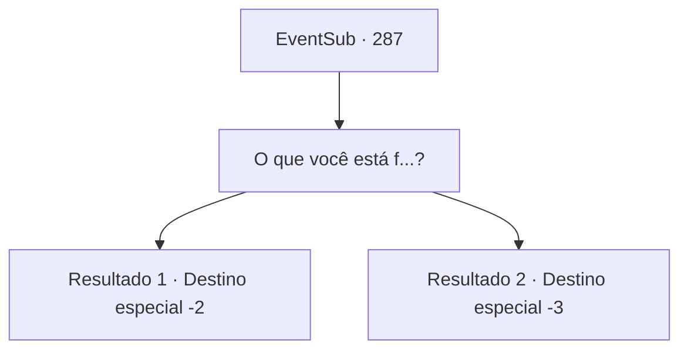

# Eventos secundários · 287

[Índice da tabela](index.md) · [Índice geral](../index.md)

ID: `pt:EventSub:287` · Fonte: `EventSub4` · Versão: 1.2.47.

Mapeamento estático dos arquivos; a disponibilidade e a execução dependem do estado da run.

## Texto do evento

*Sem texto no arquivo.*

## Dados de entrada

```json
{
  "id": 287,
  "grade": 1,
  "subEvent": "",
  "required": ""
}
```

## Mapa das escolhas



## Escolhas e resultados

### Escolha 1

O que você está f...?

Requisitos e outros campos da escolha:

```json
{
  "required": ""
}
```

#### Resultado 1.1

Van Goyle franze a testa, de pé ao seu lado. Ele parece estar pensando em algo. Segurando o martelo de cabeça para baixo, ele gentilmente bate seu corpo com ele. 

 "Estou me sentindo muito bem hoje. Parece que você vai dar uma milha extra hoje."

 Ele murmura para si mesmo, olhando para as montanhas, depois balança o martelo para atacá -lo. Com um tapa alto, um golpe de poder tremendo engole você. Seu corpo voa no ar e depois cai em um penhasco. 

 Quando você abre os olhos, você fica preso entre galhos. A corda que amarrou você já está solta. Você mal consegue descer a árvore. Parece que algumas partes do seu corpo estão quebradas. Você se afasta da árvore, procurando um lugar para descansar e cuidar de suas feridas.

Continuação registrada: [Destino especial `-2`](../destinos-especiais.md).

```json
{
  "required": "1_0_2",
  "chance": "1",
  "nextEvent": -2,
  "type": 2,
  "reward": "0_0_-1|12_7_-1|14_7_6"
}
```

#### Resultado 1.2

Van Goyle franze a testa, ao seu lado. Parece estar pensando em algo. Segurando seu martelo de cabeça para baixo, ele toca gentilmente seu corpo com ele. 

 "Estou me sentindo especialmente bem hoje. Parece que você vai se superar hoje."

 Ele murmura para si mesmo, olhando para as montanhas, e então balança seu martelo para te atingir. Com um estrondo alto, um golpe de tremenda força te engole. Seu corpo voa pelo ar e então cai de um penhasco.

Continuação registrada: [Destino especial `-3`](../destinos-especiais.md).

```json
{
  "required": "2_0_2",
  "chance": "1",
  "nextEvent": -3,
  "type": 2,
  "reward": "0_0_-1"
}
```

## Referências que chegam a este evento

- [Evento 282 · escolha 2 · resultado 1](0282.md#escolha-2)
- [Evento 285 · escolha 2 · resultado 1](0285.md#escolha-2)
