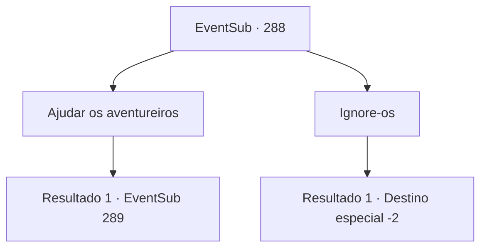

# Eventos secundários · 288

[Índice da tabela](index.md) · [Índice geral](../index.md)

ID: `pt:EventSub:288` · Fonte: `EventSub4` · Versão: 1.2.47.

Mapeamento estático dos arquivos; a disponibilidade e a execução dependem do estado da run.

## Texto do evento

Enquanto você caminha por um caminho de montanha isolado, você vê um grupo de aventureiros sendo atacados por bandidos. Eles habilmente cercam os aventureiros, ameaçando-os com suas armas.

## Dados de entrada

```json
{
  "id": 288,
  "grade": 1,
  "subEvent": "",
  "required": "12_7_6"
}
```

## Mapa das escolhas



## Escolhas e resultados

### Escolha 1

Ajudar os aventureiros

Requisitos e outros campos da escolha:

```json
{
  "required": ""
}
```

#### Resultado 1.1

Você avança e ataca os bandidos que ameaçam os aventureiros.

Continuação registrada: [Evento 289](0289.md) na mesma tabela.

```json
{
  "required": "",
  "chance": "1",
  "nextEvent": 289,
  "type": 2,
  "reward": "6_3_2",
  "place": 1
}
```

### Escolha 2

Ignore-os

Requisitos e outros campos da escolha:

```json
{
  "required": ""
}
```

#### Resultado 2.1

Você decide não ajudar os aventureiros e seguir seu caminho. Enquanto você está se afastando sorrateiramente, tentando ao máximo não chamar a atenção dos bandidos, você ouve uma voz familiar vindo dos bandidos. Somente depois de estar longe daquela cena é que você se lembra do dono daquela voz. É o Benjamin. Depois de perder sua cidade natal para os bandidos, aparentemente ele se tornou um bandido também, apontando sua arma para outras pessoas para sobreviver. Você volta rapidamente para ver se ele ainda está lá, mas todos eles não estão em lugar algum.

Continuação registrada: [Destino especial `-2`](../destinos-especiais.md).

```json
{
  "required": "",
  "chance": "1",
  "nextEvent": -2,
  "type": 2,
  "reward": "12_7_-1|14_7_2"
}
```

## Referências que chegam a este evento

Nenhum `nextEvent` positivo da mesma tabela aponta para este nó. Isso não prova que seja inacessível: sorteio e estado de história podem selecioná-lo.

