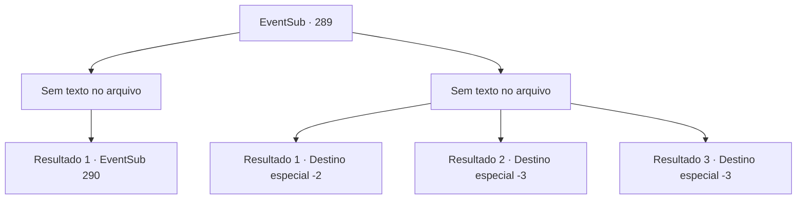

# Eventos secundários · 289

[Índice da tabela](index.md) · [Índice geral](../index.md)

ID: `pt:EventSub:289` · Fonte: `EventSub4` · Versão: 1.2.47.

Mapeamento estático dos arquivos; a disponibilidade e a execução dependem do estado da run.

## Texto do evento

*Sem texto no arquivo.*

## Dados de entrada

```json
{
  "id": 289,
  "grade": 1,
  "subEvent": "",
  "required": ""
}
```

## Mapa das escolhas



## Escolhas e resultados

### Escolha 1

*Sem texto no arquivo; o papel dessa opção depende da interface do jogo.*

Requisitos e outros campos da escolha:

```json
{
  "required": ""
}
```

#### Resultado 1.1

Você dá uma olhada nos sobreviventes, limpando o sangue da sua arma. Agora, o único bandido de pé é aquele que parece ser o líder. Conforme você se aproxima dele, com sua arma agora limpa novamente, ele tira o capuz e grita. 

 "Oh, aventureiro! Sou eu! Benjamin!"

 Surpreendentemente, realmente é Benjamin. O garoto que perdeu sua cidade natal para os bandidos e jurou vingança. Ele se ajoelha, pedindo perdão.

Continuação registrada: [Evento 290](0290.md) na mesma tabela.

```json
{
  "required": "",
  "chance": "1",
  "nextEvent": 290,
  "type": 2,
  "reward": ""
}
```

### Escolha 2

*Sem texto no arquivo; o papel dessa opção depende da interface do jogo.*

Requisitos e outros campos da escolha:

```json
{
  "required": ""
}
```

#### Resultado 2.1

Os aventureiros te jogam para distração e fogem. Os bandidos agora sacam suas armas e se aproximam de você. Você sente que é aqui que tudo acaba para você. Mas então... 

 "H, espere! PARE!"

 ...quem parece ser o líder dos bandidos grita, impedindo os outros de te matar. Quando você olha para cima para ver o que diabos está acontecendo, percebe que o rosto do líder, embora coberto por um pano apertado, parece muito familiar para Benjamin. 

 "...Apenas vá! Eu vou te deixar viver, então não faça perguntas. Suma daqui!"

 Ele te ordena a ir embora, balançando desajeitadamente sua adaga. Você rapidamente se retira, antes que os bandidos mudem de ideia.

Continuação registrada: [Destino especial `-2`](../destinos-especiais.md).

```json
{
  "required": "1_0_2|1_1_2",
  "chance": "1",
  "nextEvent": -2,
  "type": 2,
  "reward": "12_7_-1|14_7_2"
}
```

#### Resultado 2.2

Uma das lâminas dos bandidos voa diretamente para o seu peito. Os aventureiros já fugiram enquanto você estava lutando contra os bandidos, então não há ninguém para te ajudar. Você sente sua visão escurecendo, incapaz de manter sua consciência nítida.

Continuação registrada: [Destino especial `-3`](../destinos-especiais.md).

```json
{
  "required": "2_0_2",
  "chance": "1",
  "nextEvent": -3,
  "type": 2,
  "reward": "0_0_-1|0_1_-1"
}
```

#### Resultado 2.3

Uma das lâminas dos bandidos voa diretamente para o seu peito. Os aventureiros já fugiram enquanto você estava lutando contra os bandidos, então não há ninguém para te ajudar. Você sente sua visão escurecendo, incapaz de manter sua consciência nítida.

Continuação registrada: [Destino especial `-3`](../destinos-especiais.md).

```json
{
  "required": "2_1_2",
  "chance": "1",
  "nextEvent": -3,
  "type": 2,
  "reward": "0_0_-1|0_1_-1"
}
```

## Referências que chegam a este evento

- [Evento 288 · escolha 1 · resultado 1](0288.md#escolha-1)
