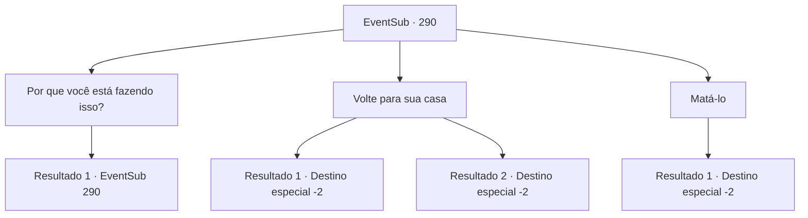

# Eventos secundários · 290

[Índice da tabela](index.md) · [Índice geral](../index.md)

ID: `pt:EventSub:290` · Fonte: `EventSub4` · Versão: 1.2.47.

Mapeamento estático dos arquivos; a disponibilidade e a execução dependem do estado da run.

## Texto do evento

*Sem texto no arquivo.*

## Dados de entrada

```json
{
  "id": 290,
  "grade": 1,
  "subEvent": "",
  "required": ""
}
```

## Mapa das escolhas



## Escolhas e resultados

### Escolha 1

Por que você está fazendo isso?

Requisitos e outros campos da escolha:

```json
{
  "required": "5_265_0"
}
```

#### Resultado 1.1

Você pergunta a Benjamin o que ele está fazendo em um lugar como este. Benjamin, sem conseguir manter contato visual com você, começa a falar sobre como ele também não queria que isso acontecesse. 

 "Eu só pensei... que precisaria de mais aliados se fosse enfrentar meu arqui-inimigo... e pensei que também precisaria de algum dinheiro. Então..."

 Benjamin continua falando sobre como suas ações são justificadas, embora pareça que ele esteja improvisando. Mas mesmo levando tudo isso em consideração, ele parece ser muito proficiente em banditismo.

Continuação registrada: [Evento 290](0290.md) na mesma tabela.

```json
{
  "required": "",
  "chance": "1",
  "nextEvent": 290,
  "type": 2,
  "reward": "5_265_1"
}
```

### Escolha 2

Volte para sua casa

Requisitos e outros campos da escolha:

```json
{
  "required": "5_265_1"
}
```

#### Resultado 2.1

Você diz calmamente a Benjamin que ele deveria voltar para sua cidade natal e esquecer tudo relacionado à vingança. Ao ouvir isso, Benjamin começa a soluçar e eventualmente deixa a faca cair no chão. Ele então começa a caminhar em direção ao sul - a direção da cidade natal de Benjamin. Assim que Benjamin se afasta, os aventureiros agradecem a você e lhe entregam uma bolsa cheia de ouro. 

 "Um, uh... obrigado por nos ajudar lá."

 Você aceita alegremente a bolsa e se despede dos aventureiros.

Continuação registrada: [Destino especial `-2`](../destinos-especiais.md).

```json
{
  "required": "",
  "chance": "1|0_7_1",
  "nextEvent": -2,
  "type": 0,
  "reward": "5_265_2|12_7_8|0_4_50"
}
```

#### Resultado 2.2

Você diz calmamente a Benjamin que ele deveria voltar para sua cidade natal e esquecer tudo relacionado à vingança. Ao ouvir isso, Benjamin se levanta lentamente, seus olhos ainda fixos em você, e foge apressadamente. Ele então segue em direção ao sul - a direção da cidade natal de Benjamin. Assim que Benjamin se afasta, os aventureiros agradecem a você e lhe entregam uma bolsa cheia de ouro. 

 "Um, uh... obrigado por nos ajudar lá."

 Você aceita felizmente a bolsa e se despede dos aventureiros.

Continuação registrada: [Destino especial `-2`](../destinos-especiais.md).

```json
{
  "required": "",
  "chance": "13",
  "nextEvent": -2,
  "type": 1,
  "reward": "5_265_2|12_7_-1|14_7_2|0_4_50"
}
```

### Escolha 3

Matá-lo

Requisitos e outros campos da escolha:

```json
{
  "required": "2_3_0"
}
```

#### Resultado 3.1

Você acaba com Benjamin. Assim que ele cai morto, os aventureiros que fugiram voltam até você. 

 "Um, uh... obrigado por nos ajudar."

 Eles te entregam uma bolsa cheia de ouro, e você aceita o pagamento felizmente.

Continuação registrada: [Destino especial `-2`](../destinos-especiais.md).

```json
{
  "required": "",
  "chance": "1",
  "nextEvent": -2,
  "type": 2,
  "reward": "5_265_2|12_7_-1|0_4_50|14_7_7"
}
```

## Referências que chegam a este evento

- [Evento 289 · escolha 1 · resultado 1](0289.md#escolha-1)
- [Evento 290 · escolha 1 · resultado 1](0290.md#escolha-1)
