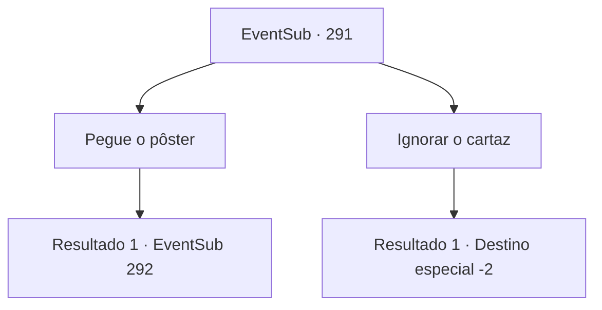

# Eventos secundários · 291

[Índice da tabela](index.md) · [Índice geral](../index.md)

ID: `pt:EventSub:291` · Fonte: `EventSub4` · Versão: 1.2.47.

Mapeamento estático dos arquivos; a disponibilidade e a execução dependem do estado da run.

## Texto do evento

A chuva parece não acabar, caindo desde a manhã até depois do pôr do sol. Não é uma tempestade nem nada, apenas uma brisa leve, mas ainda é suficiente para molhar suas roupas. Ao procurar um lugar para se proteger do clima, você encontra um cartaz de procurado nas ruas. Van Goyle, estimado em 50 anos, procurado por assalto à mão armada e assassinato, morto ou vivo. Paradeiro desconhecido. Recompensa: 300 ouros. 

 O pôster descreve brevemente a aparência do criminoso procurado, um pequeno registro de seus crimes e a recompensa por sua cabeça. Você tenta se lembrar da última vez que o viu. Van Goyle, que perdeu a perna para a espada de Benjamin. 'Paradeiro desconhecido' significava que ele provavelmente não estava mais na cidadela.

## Dados de entrada

```json
{
  "id": 291,
  "grade": 1,
  "subEvent": "",
  "required": "12_7_11"
}
```

## Mapa das escolhas



## Escolhas e resultados

### Escolha 1

Pegue o pôster

Requisitos e outros campos da escolha:

```json
{
  "required": ""
}
```

#### Resultado 1.1

Enquanto você se afasta das ruas, com o cartaz de procurado em suas mãos, você nota algumas pegadas estranhas no chão. As pegadas do pé esquerdo estão claramente lá. Mas onde as pegadas do pé direito deveriam estar, estão preenchidas com marcas que só podem ser feitas com uma bengala. Julgando pelo tamanho das pegadas visíveis, o dono delas deve ser enorme. Nesse momento, a identidade de um homem enorme e musculoso que perdeu uma de suas pernas vem à sua mente.

Continuação registrada: [Evento 292](0292.md) na mesma tabela.

```json
{
  "required": "",
  "chance": "1",
  "nextEvent": 292,
  "type": 2,
  "reward": ""
}
```

### Escolha 2

Ignorar o cartaz

Requisitos e outros campos da escolha:

```json
{
  "required": ""
}
```

#### Resultado 2.1

Você ignora o cartaz de procurado e passa por ele.

Continuação registrada: [Destino especial `-2`](../destinos-especiais.md).

```json
{
  "required": "",
  "chance": "1",
  "nextEvent": -2,
  "type": 2,
  "reward": "12_7_-1"
}
```

## Referências que chegam a este evento

Nenhum `nextEvent` positivo da mesma tabela aponta para este nó. Isso não prova que seja inacessível: sorteio e estado de história podem selecioná-lo.

