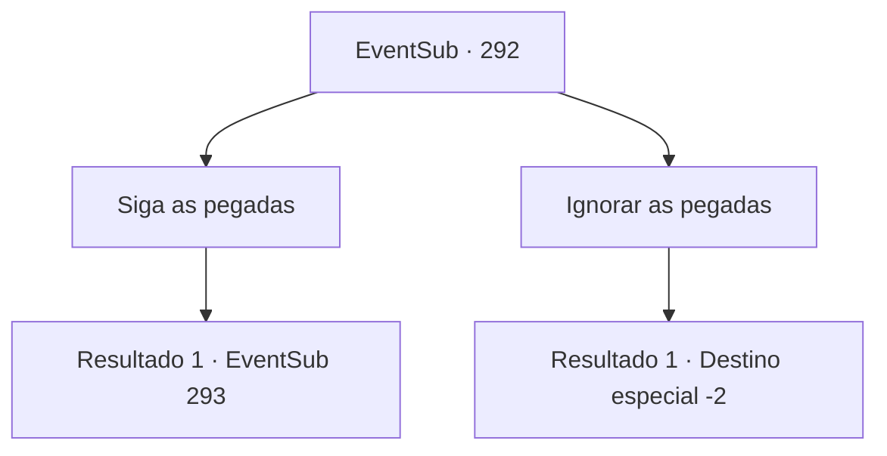

# Eventos secundários · 292

[Índice da tabela](index.md) · [Índice geral](../index.md)

ID: `pt:EventSub:292` · Fonte: `EventSub4` · Versão: 1.2.47.

Mapeamento estático dos arquivos; a disponibilidade e a execução dependem do estado da run.

## Texto do evento

*Sem texto no arquivo.*

## Dados de entrada

```json
{
  "id": 292,
  "grade": 1,
  "subEvent": "",
  "required": ""
}
```

## Mapa das escolhas



## Escolhas e resultados

### Escolha 1

Siga as pegadas

Requisitos e outros campos da escolha:

```json
{
  "required": ""
}
```

#### Resultado 1.1

Você segue os passos de aparência estranha nas montanhas. Você percorre o chão lamacento, com cada passo usando você. 

 Após cerca de dez minutos de caminhada, você se depara com uma cabana antiga. A chuva de repente começa a derramar ainda mais forte. Quando você bate na porta da cabana, a porta se abre, com o morador perguntando quem está lá. Surpreendentemente, o proprietário da cabana acaba sendo Van Goyle, o líder dos bandidos que você lutou contra a última vez. Ele abre a porta e pergunta sarcasticamente o que você está fazendo aqui, sentado na cadeira. 

 "Hmph. O que você quer?"


Continuação registrada: [Evento 293](0293.md) na mesma tabela.

```json
{
  "required": "",
  "chance": "1",
  "nextEvent": 293,
  "type": 2,
  "reward": ""
}
```

### Escolha 2

Ignorar as pegadas

Requisitos e outros campos da escolha:

```json
{
  "required": ""
}
```

#### Resultado 2.1

Você ignora as pegadas e vai para outro lugar.

Continuação registrada: [Destino especial `-2`](../destinos-especiais.md).

```json
{
  "required": "",
  "chance": "1",
  "nextEvent": -2,
  "type": 2,
  "reward": "12_7_-1"
}
```

## Referências que chegam a este evento

- [Evento 291 · escolha 1 · resultado 1](0291.md#escolha-1)
