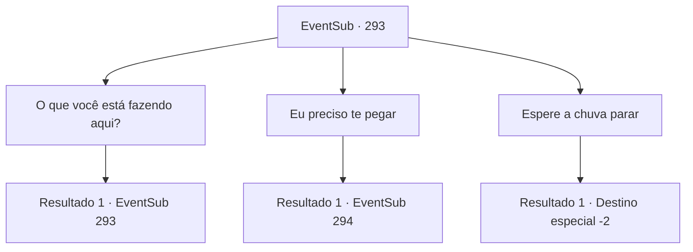

# Eventos secundários · 293

[Índice da tabela](index.md) · [Índice geral](../index.md)

ID: `pt:EventSub:293` · Fonte: `EventSub4` · Versão: 1.2.47.

Mapeamento estático dos arquivos; a disponibilidade e a execução dependem do estado da run.

## Texto do evento

*Sem texto no arquivo.*

## Dados de entrada

```json
{
  "id": 293,
  "grade": 1,
  "subEvent": "",
  "required": ""
}
```

## Mapa das escolhas



## Escolhas e resultados

### Escolha 1

O que você está fazendo aqui?

Requisitos e outros campos da escolha:

```json
{
  "required": "5_266_0"
}
```

#### Resultado 1.1

Quando você pergunta a ele o que ele está fazendo aqui, Van Goyle responde calmamente, apontando para sua perna ausente. 

 "Você não pode realmente ser um bandido com um corpo assim. Você acha que eles vão deixar um chefe fraco em paz? Pelo menos eles pouparam minha vida, por causa dos velhos tempos. Hoje em dia eu ganho a vida cortando lenha."

 Após se explicar, ele diz que você pode ficar na cabana até a chuva acabar.

Continuação registrada: [Evento 293](0293.md) na mesma tabela.

```json
{
  "required": "",
  "chance": "1",
  "nextEvent": 293,
  "type": 2,
  "reward": "5_266_1"
}
```

### Escolha 2

Eu preciso te pegar

Requisitos e outros campos da escolha:

```json
{
  "required": "5_266_1"
}
```

#### Resultado 2.1

Você pega o cartaz de procurado com as informações de Van Goyle e diz que vai pegá-lo. Ele solta um longo suspiro e levanta-se da cadeira. 

 "*suspiro*... Você realmente poderia ter ficado aqui até a chuva parar. Você está tornando isso muito mais difícil do que precisa ser."

 Ele então pega seu martelo gigante, colocado ao lado das paredes.

Continuação registrada: [Evento 294](0294.md) na mesma tabela.

```json
{
  "required": "",
  "chance": "1",
  "nextEvent": 294,
  "type": 2,
  "reward": "6_2_119",
  "place": 1
}
```

### Escolha 3

Espere a chuva parar

Requisitos e outros campos da escolha:

```json
{
  "required": "5_266_1"
}
```

#### Resultado 3.1

Você fica quieto na cabana, sentado em uma das outras cadeiras, esperando a chuva parar. Van Goyle está lendo um livro antigo e empoeirado, e você está olhando pela janela, ouvindo o som das gotas de chuva batendo no vidro. Depois de horas de silêncio, a chuva finalmente para. Enquanto você se prepara para sair, Van Goyle fala. 

 "A marreta. Leve-a com você. Eu não preciso mais dela."

 Ele aponta para a marreta gigante, colocada ao lado das paredes. Você deixa a cabana com a marreta dele.

Continuação registrada: [Destino especial `-2`](../destinos-especiais.md).

```json
{
  "required": "",
  "chance": "1",
  "nextEvent": -2,
  "type": 2,
  "reward": "12_7_-1|3_231_1"
}
```

## Referências que chegam a este evento

- [Evento 292 · escolha 1 · resultado 1](0292.md#escolha-1)
- [Evento 293 · escolha 1 · resultado 1](0293.md#escolha-1)
