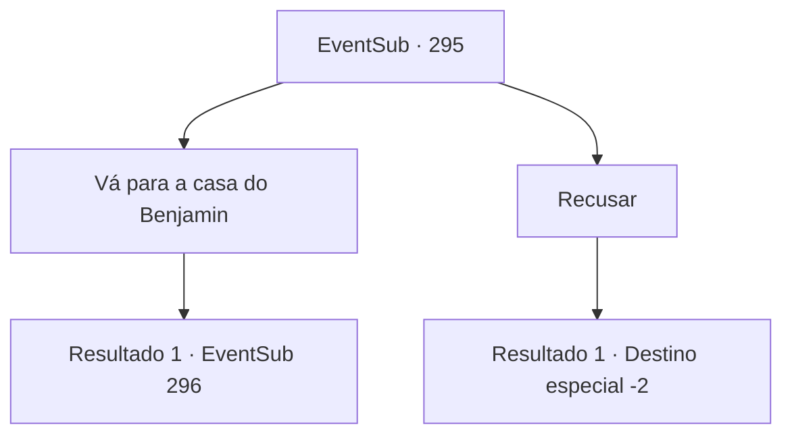

# Eventos secundários · 295

[Índice da tabela](index.md) · [Índice geral](../index.md)

ID: `pt:EventSub:295` · Fonte: `EventSub4` · Versão: 1.2.47.

Mapeamento estático dos arquivos; a disponibilidade e a execução dependem do estado da run.

## Texto do evento

Enquanto você está andando por 'Vignon', você se depara com Benjamin. Ele o cumprimenta calorosamente, acolhendo sua presença. 

 "{1}! Já faz muito tempo. Ouvi falar de você vindo para esta parte da cidade e estava esperando sua chegada."

 Ele sorri e aperta sua mão. Ele então pede que você pare na casa dele e que ele queira lhe oferecer uma refeição.

## Dados de entrada

```json
{
  "id": 295,
  "grade": 2,
  "subEvent": "",
  "required": "12_7_10|18_263_1"
}
```

## Mapa das escolhas



## Escolhas e resultados

### Escolha 1

Vá para a casa do Benjamin

Requisitos e outros campos da escolha:

```json
{
  "required": ""
}
```

#### Resultado 1.1

Confirmado o seu convite, você vai para a casa de Benjamin. A casa dele é uma casa recém-construída, limpa, localizada nos arredores da vila. Assim que você entra, Benjamin o cumprimenta calorosamente. Benjamin também lhe apresenta sua noiva, 'Attna', e o leva até a mesa de jantar. Attna é uma mulher comum, vestida com roupas comuns, embora seus olhos cor de jade tenham lhe deixado uma grande impressão. 

 "Aqui está para o aventureiro a quem devo muito."

 Attna vai para a cozinha. Enquanto você espera a comida sair, Benjamin lhe serve um copo de vinho, contando-lhe várias histórias pelas quais ele passou. Depois de algum tempo, Attna retorna com a comida. 

 "Não é muito, mas por favor, aproveite."


Continuação registrada: [Evento 296](0296.md) na mesma tabela.

```json
{
  "required": "",
  "chance": "1",
  "nextEvent": 296,
  "type": 2,
  "reward": ""
}
```

### Escolha 2

Recusar

Requisitos e outros campos da escolha:

```json
{
  "required": ""
}
```

#### Resultado 2.1

Você recusa o convite de Benjamin, dizendo que está muito ocupado no momento. Desapontado, Benjamin pede que você visite na próxima vez.

Continuação registrada: [Destino especial `-2`](../destinos-especiais.md).

```json
{
  "required": "",
  "chance": "1",
  "nextEvent": -2,
  "type": 2,
  "reward": "12_7_-1"
}
```

## Referências que chegam a este evento

Nenhum `nextEvent` positivo da mesma tabela aponta para este nó. Isso não prova que seja inacessível: sorteio e estado de história podem selecioná-lo.

