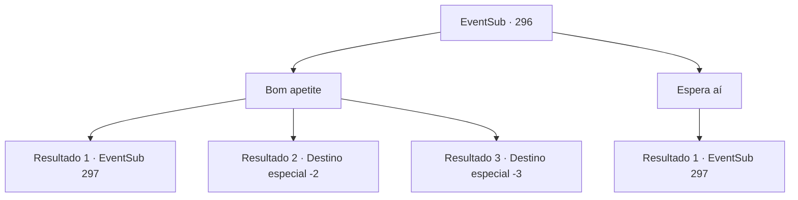

# Eventos secundários · 296

[Índice da tabela](index.md) · [Índice geral](../index.md)

ID: `pt:EventSub:296` · Fonte: `EventSub4` · Versão: 1.2.47.

Mapeamento estático dos arquivos; a disponibilidade e a execução dependem do estado da run.

## Texto do evento

*Sem texto no arquivo.*

## Dados de entrada

```json
{
  "id": 296,
  "grade": 1,
  "subEvent": "",
  "required": ""
}
```

## Mapa das escolhas



## Escolhas e resultados

### Escolha 1

Bom apetite

Requisitos e outros campos da escolha:

```json
{
  "required": ""
}
```

#### Resultado 1.1

A comida que ela preparou são de porco de tamanho adequado, sopa de legumes e um pouco de pão de cevada. Eles não são nada muito chiques, mas têm aquele sabor acolhedor e acolhedor. De repente, enquanto desfruta da sua refeição, você sente uma pontada repentina no seu peito. Você tropeça da dor, e Benjamin cai no chão, segurando o peito. Vendo você e Benjamin sofrendo com a dor, Attna começa a falar, em uma voz tão fria quanto o inverno. <color=red>

 "Você não tem ideia de quanto tempo esperei por uma oportunidade de matar vocês de uma só vez... vá para o inferno. Meu pai estará esperando."

 </color> Parece que ela envenenou a comida. Mas seu corpo saudável começa rapidamente a quebrar o veneno e você consegue se levantar, com os olhos fixos em Attna. Quando ela vê você resistindo ao veneno, Attna suspira e começa a dar um passo atrás.

Continuação registrada: [Evento 297](0297.md) na mesma tabela.

```json
{
  "required": "",
  "chance": "1|0_13_1",
  "nextEvent": 297,
  "type": 0,
  "reward": "5_267_1"
}
```

#### Resultado 1.2

A comida que ela preparou são de porco de tamanho adequado, sopa de legumes e um pouco de pão de cevada. Eles não são nada muito chiques, mas têm aquele sabor acolhedor e acolhedor. De repente, enquanto desfruta da sua refeição, você sente uma pontada repentina no seu peito. Você tropeça da dor, e Benjamin cai no chão, segurando o peito. Vendo você e Benjamin sofrendo com a dor, Attna começa a falar, em uma voz tão fria quanto o inverno. <color=red>

 "Você não tem ideia de quanto tempo esperei por uma oportunidade de matar vocês de uma só vez... vá para o inferno. Meu pai estará esperando."

</color> Essa é a última coisa que você se lembra de Attna. Parece que ela envenenou a comida.

 Depois de algumas horas, você recupera a consciência e percebe que o lugar em que está é escuro e úmido. Você move os braços e as pernas, tentando cavar a escuridão. Você finalmente vê a luz do dia novamente. Ao lado de você, está o túmulo de Benjamin. Você apressadamente cavou a sujeira, mas ele já parou de respirar. Sem mais nada a fazer, você enterra o corpo de Benjamin de volta no chão.

Continuação registrada: [Destino especial `-2`](../destinos-especiais.md).

```json
{
  "required": "1_0_2",
  "chance": "13",
  "nextEvent": -2,
  "type": 1,
  "reward": "0_0_-1|12_7_-1|14_7_4"
}
```

#### Resultado 1.3

A comida que ela preparou são de porco de tamanho adequado, sopa de legumes e um pouco de pão de cevada. Eles não são nada muito chiques, mas têm aquele sabor acolhedor e acolhedor. De repente, enquanto desfruta da sua refeição, você sente uma pontada repentina no seu peito. Você tropeça da dor, e Benjamin cai no chão, segurando o peito. Vendo você e Benjamin sofrendo com a dor, Attna começa a falar, em uma voz tão fria quanto o inverno. <color=red>

 "Você não tem ideia de quanto tempo esperei por uma oportunidade de matar vocês de uma só vez ... vá para o inferno. Meu pai estará esperando."

</color> Essa é a última coisa que você se lembra de Attna. Parece que ela envenenou a comida. Incapaz de lidar com o veneno percorrendo suas veias, você perde a consciência e entra em colapso.

Continuação registrada: [Destino especial `-3`](../destinos-especiais.md).

```json
{
  "required": "2_0_2",
  "chance": "13",
  "nextEvent": -3,
  "type": 1,
  "reward": "0_0_-1"
}
```

### Escolha 2

Espera aí

Requisitos e outros campos da escolha:

```json
{
  "required": "1_14_14"
}
```

#### Resultado 2.1

Você rapidamente impede Benjamin de beber a sopa. Benjamin pergunta o que você está fazendo, confuso. Você pergunta a Attna sobre o que ela está tentando realizar. Attna olha brevemente nos seus olhos por um momento antes de suspirar e responder. 

 "Estou surpresa que você tenha conseguido descobrir isso. Você está certo. A sopa está envenenada."

 O tom da voz dela se torna sem emoção e calmo. Um silêncio constrangedor agora preenche a casa como uma calma antes da tempestade.

Continuação registrada: [Evento 297](0297.md) na mesma tabela.

```json
{
  "required": "",
  "chance": "1",
  "nextEvent": 297,
  "type": 2,
  "reward": ""
}
```

## Referências que chegam a este evento

- [Evento 295 · escolha 1 · resultado 1](0295.md#escolha-1)
