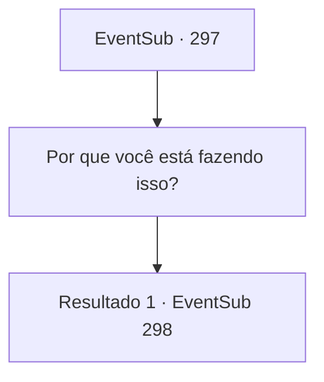

# Eventos secundários · 297

[Índice da tabela](index.md) · [Índice geral](../index.md)

ID: `pt:EventSub:297` · Fonte: `EventSub4` · Versão: 1.2.47.

Mapeamento estático dos arquivos; a disponibilidade e a execução dependem do estado da run.

## Texto do evento

*Sem texto no arquivo.*

## Dados de entrada

```json
{
  "id": 297,
  "grade": 1,
  "subEvent": "",
  "required": ""
}
```

## Mapa das escolhas



## Escolhas e resultados

### Escolha 1

Por que você está fazendo isso?

Requisitos e outros campos da escolha:

```json
{
  "required": ""
}
```

#### Resultado 1.1

Para a sua pergunta, Attna responde puxando uma adaga. 

 "...Vocês dois mataram meu pai."

 Acontece que ela é filha de Van Goyle. 

 "Eu sempre pensei que Benjamin seria o alvo mais fácil, mais fácil do que você pelo menos. Honestamente, eu não achava que você cairia nisso tão facilmente, mas nunca esperei que o veneno não fosse suficiente..."

 Ela então se aproxima de você, a adaga ainda pronta. 

 "Eu vou te matar!!"

 Attna empurra a mesa, jogando-a no chão, e avança em sua direção.

Continuação registrada: [Evento 298](0298.md) na mesma tabela.

```json
{
  "required": "",
  "chance": "1",
  "nextEvent": 298,
  "type": 2,
  "reward": "6_0_120",
  "place": 10
}
```

## Referências que chegam a este evento

- [Evento 296 · escolha 1 · resultado 1](0296.md#escolha-1)
- [Evento 296 · escolha 2 · resultado 1](0296.md#escolha-2)
