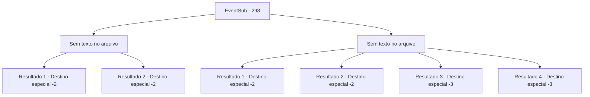

# Eventos secundários · 298

[Índice da tabela](index.md) · [Índice geral](../index.md)

ID: `pt:EventSub:298` · Fonte: `EventSub4` · Versão: 1.2.47.

Mapeamento estático dos arquivos; a disponibilidade e a execução dependem do estado da run.

## Texto do evento

*Sem texto no arquivo.*

## Dados de entrada

```json
{
  "id": 298,
  "grade": 1,
  "subEvent": "",
  "required": ""
}
```

## Mapa das escolhas



## Escolhas e resultados

### Escolha 1

*Sem texto no arquivo; o papel dessa opção depende da interface do jogo.*

Requisitos e outros campos da escolha:

```json
{
  "required": ""
}
```

#### Resultado 1.1

Você lida com Attna e pergunta a Benjamin o que ele vai fazer. Benjamin parece chocado. Seu olhar cai no chão por um bom tempo. Então, finalmente ele fala com uma voz sem emoção. 

 "Vou cuidar do resto. E... sinto muito por ter te envolvido nisso. Por favor, leve isso."

 Você deixa Benjamin e Attna, saindo da casa deles.

Continuação registrada: [Destino especial `-2`](../destinos-especiais.md).

```json
{
  "required": "18_267_1",
  "chance": "1",
  "nextEvent": -2,
  "type": 2,
  "reward": "12_7_-1|14_7_5"
}
```

#### Resultado 1.2

Você lida com Attna e rapidamente sai procurando um médico. Felizmente, o médico chega antes que seja tarde demais para Benjamin e logo ele abre os olhos novamente. Você explica tudo sobre Attna e pergunta o que ele vai fazer. 

 "Então ela era filha de Van Goyle e se aproximou de mim deliberadamente para cumprir sua vingança..."

 Benjamin parece chocado. Seu olhar cai no chão por um bom tempo. Então, finalmente, ele fala com uma voz sem emoção. 

 "Eu cuidarei do resto. E... sinto muito por ter te envolvido nisso. Por favor, pegue isso."

 Você deixa Benjamin e Attna, saindo da casa deles.

Continuação registrada: [Destino especial `-2`](../destinos-especiais.md).

```json
{
  "required": "5_267_1",
  "chance": "1",
  "nextEvent": -2,
  "type": 2,
  "reward": "12_7_-1|14_7_5"
}
```

### Escolha 2

*Sem texto no arquivo; o papel dessa opção depende da interface do jogo.*

Requisitos e outros campos da escolha:

```json
{
  "required": ""
}
```

#### Resultado 2.1

Você mal consegue distrair Attna e fugir em segurança. Benjamin provavelmente já está morto. Você não tem outra opção a não ser fugir.

Continuação registrada: [Destino especial `-2`](../destinos-especiais.md).

```json
{
  "required": "5_267_1|1_0_2|1_1_2",
  "chance": "1",
  "nextEvent": -2,
  "type": 2,
  "reward": "12_7_-1|14_7_4|0_0_-1|0_1_-1"
}
```

#### Resultado 2.2

Benjamin volta à realidade quando ele te vê lutando contra Attna. Ele corre em direção a Attna, tirando a adaga de suas mãos e finalmente a derrubando. 

 "Me soltem! Seus filhos da puta!! EU VOU MATAR TODOS VOCÊS!!!"

 Amarrada firmemente em cordas, Attna continua a cuspir maldições para você e Benjamin. Benjamin parece chocado. Seu olhar cai para o chão por um bom tempo. Então, finalmente ele fala com uma voz sem emoção. 

 "Eu cuidarei do resto. E... sinto muito por ter te envolvido nisso tudo. Por favor, pegue isso."

 Você deixa Benjamin e Attna, saindo da casa deles.

Continuação registrada: [Destino especial `-2`](../destinos-especiais.md).

```json
{
  "required": "18_267_1",
  "chance": "1",
  "nextEvent": -2,
  "type": 2,
  "reward": "12_7_-1|14_7_5"
}
```

#### Resultado 2.3

A adaga de Attna pousa perfeitamente em você, e você desaba no chão. Sem nem mesmo limpar o sangue respingado em seu rosto, Attna explode em risadas. 

 "Ha..haha!! AHAHAHA! MORRA... MORRA!!"

 Ela então te finaliza com um último golpe.

Continuação registrada: [Destino especial `-3`](../destinos-especiais.md).

```json
{
  "required": "5_267_1|2_0_2",
  "chance": "1",
  "nextEvent": -3,
  "type": 2,
  "reward": "0_0_-1|0_1_-1"
}
```

#### Resultado 2.4

A adaga de Attna pousa perfeitamente em você, e você desaba no chão. Sem nem mesmo limpar o sangue respingado em seu rosto, Attna explode em risadas. 

 "Ha..haha!! AHAHAHA! MORRA... MORRA!!"

 Ela então te finaliza com um último golpe.

Continuação registrada: [Destino especial `-3`](../destinos-especiais.md).

```json
{
  "required": "5_267_1|2_1_2",
  "chance": "1",
  "nextEvent": -3,
  "type": 2,
  "reward": "0_0_-1|0_1_-1"
}
```

## Referências que chegam a este evento

- [Evento 297 · escolha 1 · resultado 1](0297.md#escolha-1)
