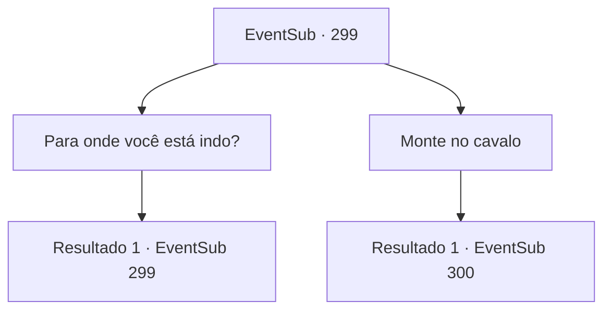

# Eventos secundários · 299

[Índice da tabela](index.md) · [Índice geral](../index.md)

ID: `pt:EventSub:299` · Fonte: `EventSub4` · Versão: 1.2.47.

Mapeamento estático dos arquivos; a disponibilidade e a execução dependem do estado da run.

## Texto do evento

Enquanto você está andando por uma estrada que atravessa as grandes planícies, um cavaleiro em um cavalo marrom aparece na sua frente. 

 "Não o vejo a tempos, {1}!"

 É Benjamin, que mergulhou na cidadela dos bandidos com você da última vez. Ele dá um sorriso brilhante, se aproxima de você e segura suas mãos, e dá um beijo nas costas de sua mão. 

 "Você foi muito difícil de rastrear. Estamos mesmo rodeando o mundo, não estamos? Eu ainda consegui encontrá-lo, depois de juntar todos os rumores e histórias. Você se importaria de me acompanhar por um tempo? Eu tenho algo que eu realmente desejo dar a você."


## Dados de entrada

```json
{
  "id": 299,
  "grade": 2,
  "subEvent": "",
  "required": "12_7_10|5_263_1"
}
```

## Mapa das escolhas



## Escolhas e resultados

### Escolha 1

Para onde você está indo?

Requisitos e outros campos da escolha:

```json
{
  "required": "5_268_0"
}
```

#### Resultado 1.1

Ele pensa brevemente antes de responder, mas logo abre a boca. 

 "Na verdade... eu queria te agradecer adequadamente por me ajudar da última vez. E convenientemente... eu tenho outro favor para te pedir... Eu realmente comprei uma casa nova recentemente. Eu estava esperando que você pudesse visitar para uma refeição ou algo assim."


Continuação registrada: [Evento 299](0299.md) na mesma tabela.

```json
{
  "required": "",
  "chance": "1",
  "nextEvent": 299,
  "type": 2,
  "reward": "5_268_1"
}
```

### Escolha 2

Monte no cavalo

Requisitos e outros campos da escolha:

```json
{
  "required": ""
}
```

#### Resultado 2.1

Você anda com Benjamin em seu cavalo. Sua casa está localizada nos arredores de 'Vignon'. A casa recém-construída é pequena, mas muito limpa. Uma senhora sai para cumprimentar você e Benjamin. 

 "Ela é a governanta que eu contratei. Seu nome é 'Attna'."

 Attna é uma mulher comum vestida com roupas comuns, embora seus olhos cor de jade tenham deixado uma grande impressão em você. Benjamin pede a Attna para trazer comida e te leva até a mesa de jantar. Attna vai para a cozinha. Enquanto você espera a comida chegar, Benjamin te serve um copo de vinho e conta várias histórias diferentes pelas quais ele passou. Depois de algum tempo, Attna retorna com a comida.

Continuação registrada: [Evento 300](0300.md) na mesma tabela.

```json
{
  "required": "",
  "chance": "1",
  "nextEvent": 300,
  "type": 2,
  "reward": ""
}
```

## Referências que chegam a este evento

- [Evento 299 · escolha 1 · resultado 1](0299.md#escolha-1)
