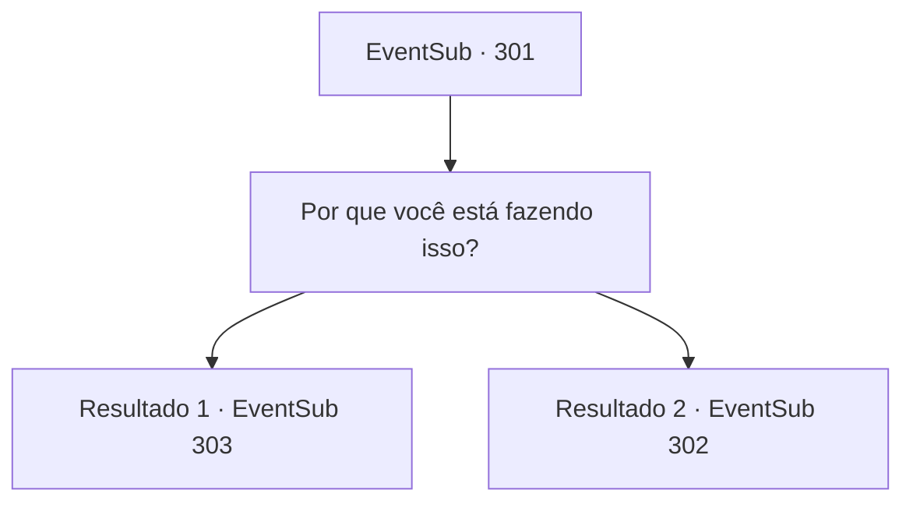

# Eventos secundários · 301

[Índice da tabela](index.md) · [Índice geral](../index.md)

ID: `pt:EventSub:301` · Fonte: `EventSub4` · Versão: 1.2.47.

Mapeamento estático dos arquivos; a disponibilidade e a execução dependem do estado da run.

## Texto do evento

*Sem texto no arquivo.*

## Dados de entrada

```json
{
  "id": 301,
  "grade": 1,
  "subEvent": "",
  "required": ""
}
```

## Mapa das escolhas



## Escolhas e resultados

### Escolha 1

Por que você está fazendo isso?

Requisitos e outros campos da escolha:

```json
{
  "required": ""
}
```

#### Resultado 1.1

Para sua pergunta, Attna responde puxando uma adaga. 

 "... vocês dois assassinaram meu pai."

 Acontece que ela é filha de Van Goyle. 

 "Eu sempre pensei que Benjamin seria o alvo mais fácil, mais fácil do que você, pelo menos. Sinceramente, não achei que você se caísse nisso tão facilmente, mas eu nunca esperava que o veneno não fosse suficiente ..."

 Ela então se aproxima de você, a adaga ainda se preparou. 

 "Eu vou matar você!!"

 Attna empurra a mesa, jogando -a no chão e cobra você. Mas Benjamin a liga com uma corda em um piscar de olhos. 

 "{1}. Por favor, espere aqui. Volto em breve."

 Ele diz que vai visitar o quartel do guarda para prendê -la e traz Attna para fora. 

 Depois de um tempo, Benjamin retorna à casa e pede desculpas a você, por arrastá -lo para tudo isso. 

 "Attna, filha de Van Goyle ...? Eu nunca teria esperado isso. Eu deveria ter sido mais cuidadoso ... me desculpe."


Continuação registrada: [Evento 303](0303.md) na mesma tabela.

```json
{
  "required": "18_267_1",
  "chance": "1",
  "nextEvent": 303,
  "type": 2,
  "reward": "12_7_-1|14_7_0"
}
```

#### Resultado 1.2

Para a sua pergunta, Attna responde puxando uma adaga. 

 "...Vocês dois mataram meu pai."

 Acontece que ela é filha de Van Goyle. 

 "Eu sempre pensei que Benjamin seria o alvo mais fácil, mais fácil do que você pelo menos. Honestamente, eu não achava que você cairia nisso tão facilmente, mas nunca esperei que o veneno não fosse suficiente..."

 Ela então se aproxima de você, a adaga ainda pronta. 

 "Eu vou te matar!!"


Continuação registrada: [Evento 302](0302.md) na mesma tabela.

```json
{
  "required": "5_267_1",
  "chance": "1",
  "nextEvent": 302,
  "type": 2,
  "reward": "6_0_120",
  "place": 10
}
```

## Referências que chegam a este evento

- [Evento 300 · escolha 1 · resultado 1](0300.md#escolha-1)
- [Evento 300 · escolha 1 · resultado 4](0300.md#escolha-1)
- [Evento 300 · escolha 2 · resultado 1](0300.md#escolha-2)
