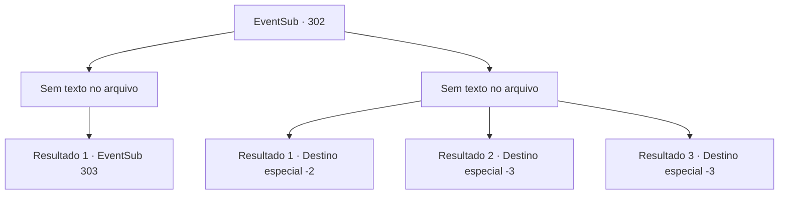

# Eventos secundários · 302

[Índice da tabela](index.md) · [Índice geral](../index.md)

ID: `pt:EventSub:302` · Fonte: `EventSub4` · Versão: 1.2.47.

Mapeamento estático dos arquivos; a disponibilidade e a execução dependem do estado da run.

## Texto do evento

*Sem texto no arquivo.*

## Dados de entrada

```json
{
  "id": 302,
  "grade": 1,
  "subEvent": "",
  "required": ""
}
```

## Mapa das escolhas



## Escolhas e resultados

### Escolha 1

*Sem texto no arquivo; o papel dessa opção depende da interface do jogo.*

Requisitos e outros campos da escolha:

```json
{
  "required": ""
}
```

#### Resultado 1.1

Você lida com Attna e rapidamente sai à procura de um médico. Felizmente, o médico chega antes que seja tarde demais para Benjamin e logo ele abre os olhos novamente. Você explica tudo sobre Attna e pergunta o que ele vai fazer. 

 "Então ela era filha de Van Goyle e se aproximou de mim de propósito para cumprir sua vingança... {1}. Por favor, espere aqui. Eu volto logo."

 Ele diz que vai visitar os alojamentos dos guardas para prendê-la e leva Attna para fora. 

 Depois de um tempo, Benjamin retorna à casa e se desculpa com você por envolvê-lo em tudo isso. 

 "Attna, filha de Van Goyle...? Nunca teria esperado isso. Deveria ter sido mais cuidadoso... E olhe para mim, aqui, mais uma vez lhe devendo minha vida. Não consigo agradecer o suficiente."


Continuação registrada: [Evento 303](0303.md) na mesma tabela.

```json
{
  "required": "",
  "chance": "1",
  "nextEvent": 303,
  "type": 2,
  "reward": "12_7_-1|14_7_0"
}
```

### Escolha 2

*Sem texto no arquivo; o papel dessa opção depende da interface do jogo.*

Requisitos e outros campos da escolha:

```json
{
  "required": ""
}
```

#### Resultado 2.1

Você mal consegue distrair Attna e fugir em segurança. Benjamin provavelmente já está morto. Você não tem outra opção a não ser fugir.

Continuação registrada: [Destino especial `-2`](../destinos-especiais.md).

```json
{
  "required": "1_0_2|1_1_2",
  "chance": "1",
  "nextEvent": -2,
  "type": 2,
  "reward": "12_7_-1|14_7_4|0_0_-1|0_1_-1"
}
```

#### Resultado 2.2

A adaga de Attna pousa perfeitamente em você, e você desaba no chão. Sem nem mesmo limpar o sangue respingado em seu rosto, Attna explode em risadas. 

 "Ha..haha!! AHAHAHA! MORRA... MORRA!!"

 Ela então te finaliza com um último golpe.

Continuação registrada: [Destino especial `-3`](../destinos-especiais.md).

```json
{
  "required": "2_0_2",
  "chance": "1",
  "nextEvent": -3,
  "type": 2,
  "reward": "0_0_-1|0_1_-1"
}
```

#### Resultado 2.3

A adaga de Attna pousa perfeitamente em você, e você desaba no chão. Sem nem mesmo limpar o sangue respingado em seu rosto, Attna explode em risadas. 

 "Ha..haha!! AHAHAHA! MORRA... MORRA!!"

 Ela então te finaliza com um último golpe.

Continuação registrada: [Destino especial `-3`](../destinos-especiais.md).

```json
{
  "required": "2_1_2",
  "chance": "1",
  "nextEvent": -3,
  "type": 2,
  "reward": "0_0_-1|0_1_-1"
}
```

## Referências que chegam a este evento

- [Evento 301 · escolha 1 · resultado 2](0301.md#escolha-1)
