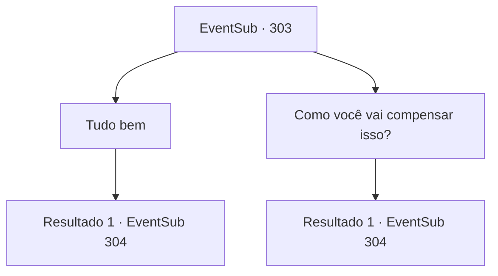

# Eventos secundários · 303

[Índice da tabela](index.md) · [Índice geral](../index.md)

ID: `pt:EventSub:303` · Fonte: `EventSub4` · Versão: 1.2.47.

Mapeamento estático dos arquivos; a disponibilidade e a execução dependem do estado da run.

## Texto do evento

*Sem texto no arquivo.*

## Dados de entrada

```json
{
  "id": 303,
  "grade": 1,
  "subEvent": "",
  "required": ""
}
```

## Mapa das escolhas



## Escolhas e resultados

### Escolha 1

Tudo bem

Requisitos e outros campos da escolha:

```json
{
  "required": ""
}
```

#### Resultado 1.1

Você faz o seu melhor para consolá-lo, dizendo a ele que está tudo bem. Ele olha nos seus olhos e fala. 

 "Eu tenho algo que quero te mostrar. Espere um pouco.."

 Ele pega sua mão e gentilmente te leva para fora pela porta dos fundos, para fora da casa. Os campos de trigo atrás da casa de Benjamin já estão amarelos, parecendo ondas feitas de ouro. Depois de caminhar pelos campos de trigo por alguns minutos, Benjamin se vira, olhando para você, e te observa. Então ele tira um anel do bolso, apresentando-o para você. 

 "...Se você não se importar... pegue isso."

 Ele claramente está tímido. Seu olhar está fixo no chão, mas você percebe seu rosto ficando vermelho.

Continuação registrada: [Evento 304](0304.md) na mesma tabela.

```json
{
  "required": "",
  "chance": "1",
  "nextEvent": 304,
  "type": 2,
  "reward": ""
}
```

### Escolha 2

Como você vai compensar isso?

Requisitos e outros campos da escolha:

```json
{
  "required": ""
}
```

#### Resultado 2.1

Você pergunta brincando como ele vai te compensar. Ele sorri levemente, olha nos seus olhos e fala. 

 "Me siga por um segundo, por favor. Minhas desculpas... estão no quintal."

 Ele pega sua mão e gentilmente te leva para fora da porta dos fundos, para fora da casa. Os campos de trigo atrás da casa de Benjamin já estão amarelos, parecendo ondas feitas de ouro. Depois de passear pelos campos de trigo por alguns minutos, Benjamin se vira, olha para você e te observa. Então ele tira um anel do bolso, apresentando-o para você. 

 "...Isso... é minha desculpa. Se você não se importar... por favor, aceite isso."

 Ele claramente está tímido. Seu olhar está fixo no chão, mas você percebe seu rosto ficando vermelho.

Continuação registrada: [Evento 304](0304.md) na mesma tabela.

```json
{
  "required": "",
  "chance": "1",
  "nextEvent": 304,
  "type": 2,
  "reward": ""
}
```

## Referências que chegam a este evento

- [Evento 301 · escolha 1 · resultado 1](0301.md#escolha-1)
- [Evento 302 · escolha 1 · resultado 1](0302.md#escolha-1)
