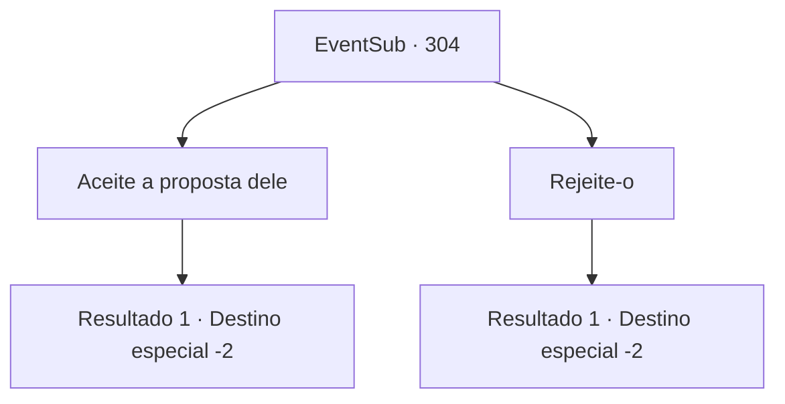

# Eventos secundários · 304

[Índice da tabela](index.md) · [Índice geral](../index.md)

ID: `pt:EventSub:304` · Fonte: `EventSub4` · Versão: 1.2.47.

Mapeamento estático dos arquivos; a disponibilidade e a execução dependem do estado da run.

## Texto do evento

*Sem texto no arquivo.*

## Dados de entrada

```json
{
  "id": 304,
  "grade": 1,
  "subEvent": "",
  "required": ""
}
```

## Mapa das escolhas



## Escolhas e resultados

### Escolha 1

Aceite a proposta dele

Requisitos e outros campos da escolha:

```json
{
  "required": "24_1_1"
}
```

#### Resultado 1.1

Você pega o anel de Benjamin e o coloca em seu dedo. Ele sorri calorosamente e olha para você. Então ele abre os braços e te abraça apertado. 

 "Obrigado... obrigado...! Eu daria qualquer coisa por você, até mesmo minha vida."

 Benjamin jura seu amor eterno a você com algo saído diretamente de histórias românticas. Você e Benjamin passam a noite inteira 'confirmando' o amor um pelo outro. 

 "Tome cuidado para não ir a lugares perigosos. E aqui..."

 Benjamin te entrega seu escudo. Ele também não esquece de te pedir para ter cuidado, para cuidar de si mesma. Você pega o escudo dele e retorna à sua aventura.

Continuação registrada: [Destino especial `-2`](../destinos-especiais.md).

```json
{
  "required": "",
  "chance": "1",
  "nextEvent": -2,
  "type": 2,
  "reward": "0_0_1|0_1_1|0_13_1|5_270_1|3_119_1|3_46_1|14_7_9"
}
```

### Escolha 2

Rejeite-o

Requisitos e outros campos da escolha:

```json
{
  "required": ""
}
```

#### Resultado 2.1

Você se recusa. Benjamin não sabe o que dizer. Ele coloca seu anel de volta no bolso. 

 "...Desculpe. Então... por favor, pegue isso, pelo menos."

 Ele apressadamente lhe entrega uma bolsa cheia de ouro e se retira para sua casa. Você simplesmente volta para a sua aventura.

Continuação registrada: [Destino especial `-2`](../destinos-especiais.md).

```json
{
  "required": "",
  "chance": "1",
  "nextEvent": -2,
  "type": 2,
  "reward": "0_4_50"
}
```

## Referências que chegam a este evento

- [Evento 303 · escolha 1 · resultado 1](0303.md#escolha-1)
- [Evento 303 · escolha 2 · resultado 1](0303.md#escolha-2)
