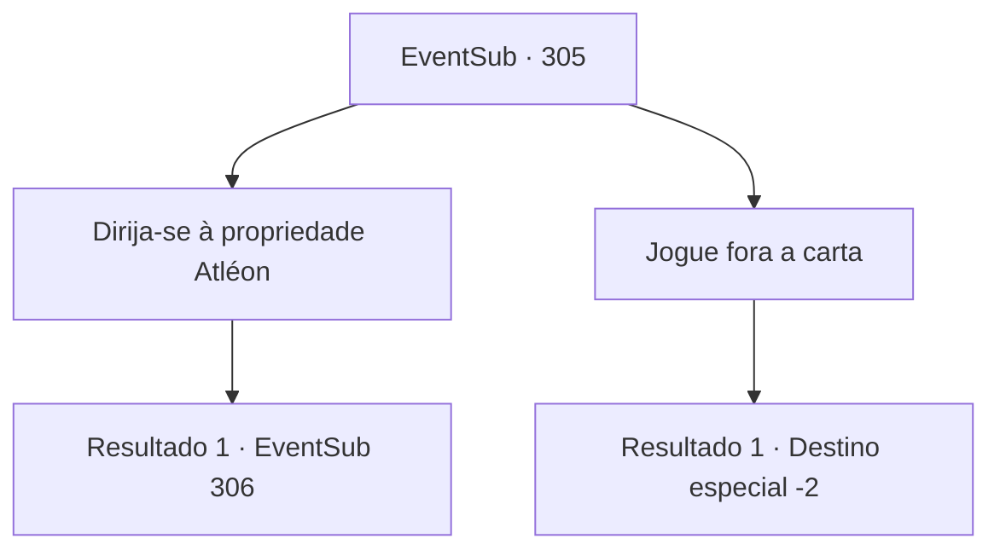

# Eventos secundários · 305

[Índice da tabela](index.md) · [Índice geral](../index.md)

ID: `pt:EventSub:305` · Fonte: `EventSub4` · Versão: 1.2.47.

Mapeamento estático dos arquivos; a disponibilidade e a execução dependem do estado da run.

## Texto do evento

Você ouve um som esvoaçante em algum lugar. Quando você olha em volta, um pombo-correio voa e se senta em seus ombros. Em sua perna há uma mensagem destinada a você. Você desamarra a mensagem do pombo e a lê. 

 "Há quanto tempo. É Alec, de Atleon. Você se lembra de Benjamin, certo? Aquele que eu aceitei como meu aprendiz? Bem, logo depois que ele se tornou um aprendiz de cavaleiro, ele simplesmente... desapareceu. Passei dias procurando por ele, e aparentemente ele foi pego por um homem chamado 'Van Goyle' depois de tentar derrotá-lo. Pelo nome Atleon, devo salvar o menino. Eu realmente aprecio sua ajuda."

 No final da carta está a localização do ponto de encontro.

## Dados de entrada

```json
{
  "id": 305,
  "grade": 1,
  "subEvent": "",
  "required": "12_7_9"
}
```

## Mapa das escolhas



## Escolhas e resultados

### Escolha 1

Dirija-se à propriedade Atléon

Requisitos e outros campos da escolha:

```json
{
  "required": ""
}
```

#### Resultado 1.1

Você segue para o ponto de encontro escrito na carta. Você caminha ocupado por alguns dias e finalmente encontra um dos homens de Alec. Ele está examinando sua armadura. Quando ele te vê, ele te dá uma calorosa recepção. 

 "Como eu esperava. Eu sabia que você viria. Obrigado."

 Alec ordena a seus servos que vistam sua armadura. Ele então se dirige aos seus soldados, que já estão preparando suas formações de batalha. 

 "Agora, homens... Vamos mostrar a eles o que acontece quando mexem com um Atléon."


Continuação registrada: [Evento 306](0306.md) na mesma tabela.

```json
{
  "required": "",
  "chance": "1",
  "nextEvent": 306,
  "type": 2,
  "reward": ""
}
```

### Escolha 2

Jogue fora a carta

Requisitos e outros campos da escolha:

```json
{
  "required": ""
}
```

#### Resultado 2.1

Você joga a carta fora. A pomba mensageira inclina a cabeça e depois voa para longe.

Continuação registrada: [Destino especial `-2`](../destinos-especiais.md).

```json
{
  "required": "",
  "chance": "1",
  "nextEvent": -2,
  "type": 2,
  "reward": "12_7_-1"
}
```

## Referências que chegam a este evento

Nenhum `nextEvent` positivo da mesma tabela aponta para este nó. Isso não prova que seja inacessível: sorteio e estado de história podem selecioná-lo.

