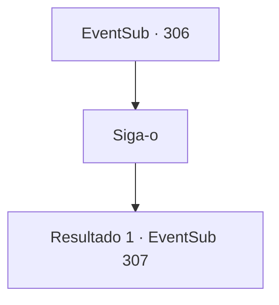

# Eventos secundários · 306

[Índice da tabela](index.md) · [Índice geral](../index.md)

ID: `pt:EventSub:306` · Fonte: `EventSub4` · Versão: 1.2.47.

Mapeamento estático dos arquivos; a disponibilidade e a execução dependem do estado da run.

## Texto do evento

*Sem texto no arquivo.*

## Dados de entrada

```json
{
  "id": 306,
  "grade": 1,
  "subEvent": "",
  "required": ""
}
```

## Mapa das escolhas



## Escolhas e resultados

### Escolha 1

Siga-o

Requisitos e outros campos da escolha:

```json
{
  "required": ""
}
```

#### Resultado 1.1

Você segue para a cidadela de Van Goyle, junto com Alec e seus soldados. Alec monta em seu cavalo e se aproxima do portão da cidadela, sozinho, e grita. 

 "VAN GOYLE! LIBERTE BENJAMIN! SE VOCÊ NÃO FIZER ISSO, EU GARANTO QUE VOCÊ E SEUS HOMENS SERÃO DESPEDAÇADOS EM PEDAÇOS, EM NOME DE Atléon!"

 Então, um homem enorme com um tapa-olho aparece dos portões do castelo. Aparentemente ele é Van Goyle. Ele bebe uma garrafa inteira de álcool de uma vez só e responde. 

 "Ah...! Você quer dizer aquele bebedor de leite? Ah, que pena. Ele já está morto."

 Ele então mostra a Alec a cabeça decepada de Benjamin, balançando-a em suas mãos. Van Goyle joga a cabeça, dizendo que é o mínimo que ele pode fazer por Alec. Alec pega a cabeça e volta para seus soldados, ordenando que se preparem para a batalha. Então ele grita o mais alto que pode. <link=shake>

 "MATEM TODOS ELES!!!"

</link> Uma batalha entre os soldados e os bandidos começa. Você se junta aos soldados, liderando o ataque contra os bandidos.

Continuação registrada: [Evento 307](0307.md) na mesma tabela.

```json
{
  "required": "",
  "chance": "1",
  "nextEvent": 307,
  "type": 2,
  "reward": "6_2_118",
  "place": 4
}
```

## Referências que chegam a este evento

- [Evento 305 · escolha 1 · resultado 1](0305.md#escolha-1)
