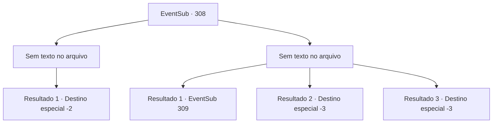

# Eventos secundários · 308

[Índice da tabela](index.md) · [Índice geral](../index.md)

ID: `pt:EventSub:308` · Fonte: `EventSub4` · Versão: 1.2.47.

Mapeamento estático dos arquivos; a disponibilidade e a execução dependem do estado da run.

## Texto do evento

*Sem texto no arquivo.*

## Dados de entrada

```json
{
  "id": 308,
  "grade": 1,
  "subEvent": "",
  "required": ""
}
```

## Mapa das escolhas



## Escolhas e resultados

### Escolha 1

*Sem texto no arquivo; o papel dessa opção depende da interface do jogo.*

Requisitos e outros campos da escolha:

```json
{
  "required": ""
}
```

#### Resultado 1.1

Você consegue capturar o líder dos bandidos também. Depois de levar uma surra de você, Van Goyle cospe sangue e cai no chão. Os bandidos restantes são capturados pelos soldados e amarrados com cordas, assim como Van Goyle. Alec se aproxima de você e te dá tapinhas nos ombros, falando. 

 "Isso teria sido muito mais difícil se não fosse por você. Obrigado por vir em meu auxílio - e da minha Casa. Eu preparei algo especial para agradecer pelos seus problemas. Por favor, aceite."

 Ele ordena que seus homens lhe forneçam uma grande quantidade de ouro. Alec então retorna à propriedade com seus homens.

Continuação registrada: [Destino especial `-2`](../destinos-especiais.md).

```json
{
  "required": "",
  "chance": "1",
  "nextEvent": -2,
  "type": 2,
  "reward": "12_7_-1|14_7_8|14_7_10|0_4_100"
}
```

### Escolha 2

*Sem texto no arquivo; o papel dessa opção depende da interface do jogo.*

Requisitos e outros campos da escolha:

```json
{
  "required": ""
}
```

#### Resultado 2.1

Você sente como se estivesse voando pelo ar por um breve momento, antes de perceber que foi atingido pelo martelo de Van Goyle. Quando você abre os olhos, percebe que está separado da luta. Um médico de campo está fazendo um curativo em uma ferida em sua cabeça. Quando você verifica como está indo a luta, vê Alec e Van Goyle duelando.

Continuação registrada: [Evento 309](0309.md) na mesma tabela.

```json
{
  "required": "1_0_2|1_1_2",
  "chance": "1",
  "nextEvent": 309,
  "type": 2,
  "reward": "0_0_-1|0_1_-1"
}
```

#### Resultado 2.2

Sente-se como se estivesse voando pelo ar por um breve momento, antes de perceber que foi atingido pelo martelo de Van Goyle. Desmaia.

Continuação registrada: [Destino especial `-3`](../destinos-especiais.md).

```json
{
  "required": "2_0_2",
  "chance": "1",
  "nextEvent": -3,
  "type": 2,
  "reward": "0_0_-1|0_1_-1"
}
```

#### Resultado 2.3

Sente-se como se estivesse voando pelo ar por um breve momento, antes de perceber que foi atingido pelo martelo de Van Goyle. Desmaia.

Continuação registrada: [Destino especial `-3`](../destinos-especiais.md).

```json
{
  "required": "2_1_2",
  "chance": "1",
  "nextEvent": -3,
  "type": 2,
  "reward": "0_0_-1|0_1_-1"
}
```

## Referências que chegam a este evento

- [Evento 307 · escolha 1 · resultado 1](0307.md#escolha-1)
