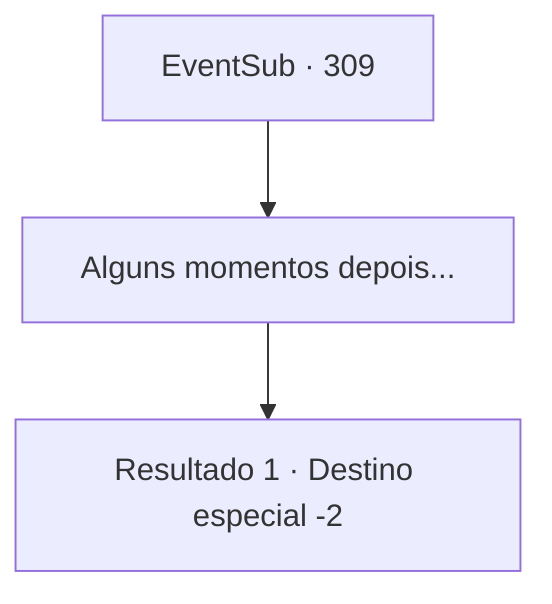

# Eventos secundários · 309

[Índice da tabela](index.md) · [Índice geral](../index.md)

ID: `pt:EventSub:309` · Fonte: `EventSub4` · Versão: 1.2.47.

Mapeamento estático dos arquivos; a disponibilidade e a execução dependem do estado da run.

## Texto do evento

*Sem texto no arquivo.*

## Dados de entrada

```json
{
  "id": 309,
  "grade": 1,
  "subEvent": "",
  "required": ""
}
```

## Mapa das escolhas



## Escolhas e resultados

### Escolha 1

Alguns momentos depois...

Requisitos e outros campos da escolha:

```json
{
  "required": ""
}
```

#### Resultado 1.1

Em breve, o resultado do duelo se revela. A lâmina de Alec joga o martelo de Van Goyle para longe de seu alcance, e Goyle acaba nas cordas. Alec coloca um capuz em sua cabeça e o monta em um dos cavalos. Ele então se aproxima de você, segurando suas mãos e expressando sua gratidão. 

 "Obrigado por vir em meu auxílio - e de minha Casa."

 Ele ordena que seus homens lhe dêem algum ouro e poções. Alec então retorna à propriedade com seus homens.

Continuação registrada: [Destino especial `-2`](../destinos-especiais.md).

```json
{
  "required": "",
  "chance": "1",
  "nextEvent": -2,
  "type": 2,
  "reward": "3_36_1|3_37_1|0_4_50|12_7_-1|14_7_8|14_7_10"
}
```

## Referências que chegam a este evento

- [Evento 307 · escolha 2 · resultado 1](0307.md#escolha-2)
- [Evento 308 · escolha 2 · resultado 1](0308.md#escolha-2)
