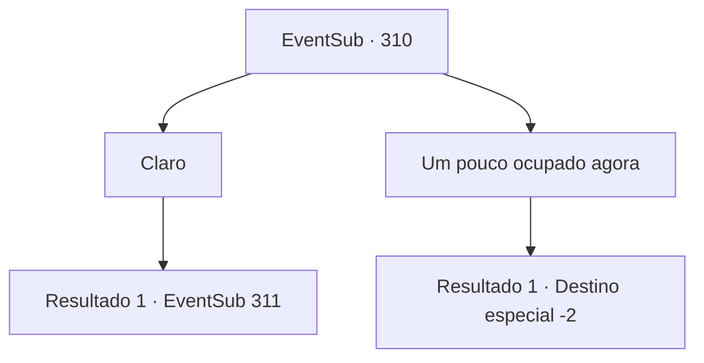

# Eventos secundários · 310

[Índice da tabela](index.md) · [Índice geral](../index.md)

ID: `pt:EventSub:310` · Fonte: `EventSub4` · Versão: 1.2.47.

Mapeamento estático dos arquivos; a disponibilidade e a execução dependem do estado da run.

## Texto do evento

Você está andando pela cidade rural 'Vignon'. Enquanto você caminha vagarosamente, observando os campos de arroz, você vê jovens agricultores andando com roupas de couro. 

 "Ah, aventureiro...!"

 Benjamin está lá também. Benjamin caminha até você e se curva em respeito. Ele conta que se casou com uma mulher da cidade chamada Sasil e que se juntou aos vigilantes da cidade, protegendo o lugar do mal. 

 "Aham, se você estava planejando ficar em nossa cidade... que tal uma taça de vinho, na minha casa?"


## Dados de entrada

```json
{
  "id": 310,
  "grade": 1,
  "subEvent": "",
  "required": "12_7_8"
}
```

## Mapa das escolhas



## Escolhas e resultados

### Escolha 1

Claro

Requisitos e outros campos da escolha:

```json
{
  "required": ""
}
```

#### Resultado 1.1

Você aceita a oferta de Benjamin e o segue até sua casa. O que parece ser uma estrutura de madeira normal por fora acaba sendo um lugar muito limpo e confortável. Você conversa com Benjamin na sala de estar, saboreando vinho. Ele também te apresenta sua esposa, que segundo ele, conheceu graças ao seu tio. 

 "Prazer em conhecê-lo. Sou 'Maria'. Já ouvi muito sobre você."

 Maria é uma mulher do campo estereotipada, com cabelos castanhos trançados. Ela pede para você esperar alguns minutos e vai para a cozinha. Enquanto você e Benjamin estão conversando, Maria começa a preparar a comida.

Continuação registrada: [Evento 311](0311.md) na mesma tabela.

```json
{
  "required": "",
  "chance": "1",
  "nextEvent": 311,
  "type": 2,
  "reward": ""
}
```

### Escolha 2

Um pouco ocupado agora

Requisitos e outros campos da escolha:

```json
{
  "required": ""
}
```

#### Resultado 2.1

Você recusa a oferta dele. Desapontado, ele sai com outros vigilantes da cidade para patrulhar a cidade. Ele te diz que espera que haja mais oportunidades no futuro.

Continuação registrada: [Destino especial `-2`](../destinos-especiais.md).

```json
{
  "required": "",
  "chance": "1",
  "nextEvent": -2,
  "type": 2,
  "reward": "12_7_-1|14_7_3"
}
```

## Referências que chegam a este evento

Nenhum `nextEvent` positivo da mesma tabela aponta para este nó. Isso não prova que seja inacessível: sorteio e estado de história podem selecioná-lo.

