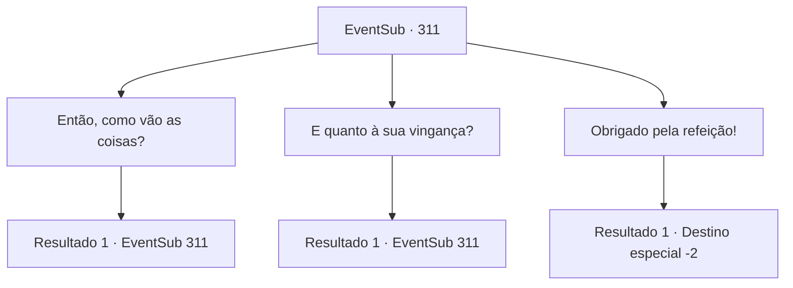

# Eventos secundários · 311

[Índice da tabela](index.md) · [Índice geral](../index.md)

ID: `pt:EventSub:311` · Fonte: `EventSub4` · Versão: 1.2.47.

Mapeamento estático dos arquivos; a disponibilidade e a execução dependem do estado da run.

## Texto do evento

*Sem texto no arquivo.*

## Dados de entrada

```json
{
  "id": 311,
  "grade": 1,
  "subEvent": "",
  "required": ""
}
```

## Mapa das escolhas



## Escolhas e resultados

### Escolha 1

Então, como vão as coisas?

Requisitos e outros campos da escolha:

```json
{
  "required": "5_272_0"
}
```

#### Resultado 1.1

Benjamin responde à sua pergunta olhando fixamente para os campos de trigo. 

 "Bem... Eu só... sabe. Espero que as coisas continuem como estão agora."

 Ele menciona que seu tio o ensinou a trabalhar em uma fazenda e que ele assumiu o lugar do tio depois que ele ficou velho demais para trabalhar na fazenda. Ele também conta que trabalha diligentemente como um dos vigilantes da cidade. Ele estufa o peito, mostrando sua confiança.

Continuação registrada: [Evento 311](0311.md) na mesma tabela.

```json
{
  "required": "",
  "chance": "1",
  "nextEvent": 311,
  "type": 2,
  "reward": "5_272_1"
}
```

### Escolha 2

E quanto à sua vingança?

Requisitos e outros campos da escolha:

```json
{
  "required": "5_272_1"
}
```

#### Resultado 2.1

Ele olha silenciosamente para fora das janelas. Você segue. A paisagem de campos de trigo lá fora. Um pequeno lago, fluindo perto deles. 

 "Ainda tenho sonhos daquele dia, quando minha cidade natal foi engolida pelas chamas... Mas... agora tenho coisas muito mais importantes com que me preocupar, Não posso agir imprudentemente, com minha mente consumida pelo desejo de vingança..."

 Enquanto vocês dois estão conversando, Maria termina de cozinhar e enche a mesa com comida. Peru assado, pão, leite e queijo. Benjamin corre para o porão e logo retorna com uma garrafa de vinho bem fermentado.

Continuação registrada: [Evento 311](0311.md) na mesma tabela.

```json
{
  "required": "",
  "chance": "1",
  "nextEvent": 311,
  "type": 2,
  "reward": "5_272_2"
}
```

### Escolha 3

Obrigado pela refeição!

Requisitos e outros campos da escolha:

```json
{
  "required": "5_272_2"
}
```

#### Resultado 3.1

Benjamin e sua esposa lhe proporcionaram um jantar mais do que suficiente. Você também desfruta de um sono tranquilo em uma cama adequada em um lugar acolhedor. No dia seguinte, você se despede de Benjamin e sai de sua casa.

Continuação registrada: [Destino especial `-2`](../destinos-especiais.md).

```json
{
  "required": "",
  "chance": "1",
  "nextEvent": -2,
  "type": 2,
  "reward": "0_0_1|0_1_1|12_7_-1|14_7_3"
}
```

## Referências que chegam a este evento

- [Evento 310 · escolha 1 · resultado 1](0310.md#escolha-1)
- [Evento 311 · escolha 1 · resultado 1](0311.md#escolha-1)
- [Evento 311 · escolha 2 · resultado 1](0311.md#escolha-2)
