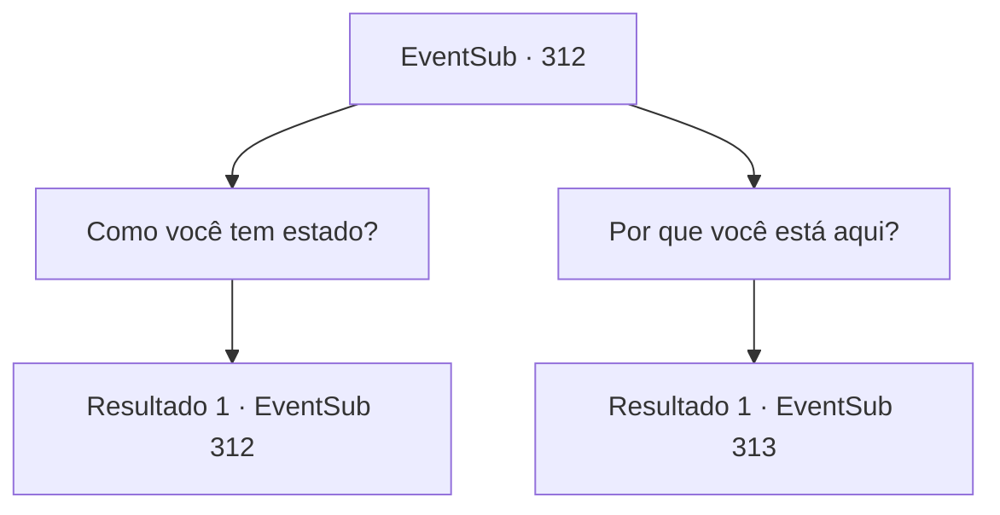

# Eventos secundários · 312

[Índice da tabela](index.md) · [Índice geral](../index.md)

ID: `pt:EventSub:312` · Fonte: `EventSub4` · Versão: 1.2.47.

Mapeamento estático dos arquivos; a disponibilidade e a execução dependem do estado da run.

## Texto do evento


 "{1}!"

 Uma voz familiar o interrompe. Você olha para trás. É Benjamim. Ele está vestindo uma armadura lindamente decorada, com suas placas adornadas em amarelo e vermelho.

## Dados de entrada

```json
{
  "id": 312,
  "grade": 1,
  "subEvent": "",
  "required": "12_7_12|5_260_1"
}
```

## Mapa das escolhas



## Escolhas e resultados

### Escolha 1

Como você tem estado?

Requisitos e outros campos da escolha:

```json
{
  "required": "5_276_0"
}
```

#### Resultado 1.1

Benjamin toca sua espada em sua cintura em resposta. 

 "Graças ao que você me ensinou, aventureiro, estou ganhando muito dinheiro como mercenário. Obrigado."


Continuação registrada: [Evento 312](0312.md) na mesma tabela.

```json
{
  "required": "",
  "chance": "1",
  "nextEvent": 312,
  "type": 2,
  "reward": "5_276_1"
}
```

### Escolha 2

Por que você está aqui?

Requisitos e outros campos da escolha:

```json
{
  "required": ""
}
```

#### Resultado 2.1

Benjamin apaga o sorriso do rosto e fala em um tom sério. 

 "Estou pronto. Digo que já é hora de eu completar minha vingança. Eu estava esperando te ver antes de partir. Novamente, obrigado por me ajudar no passado."

 Ele te dá algum ouro como um símbolo de sua gratidão e vai embora.

Continuação registrada: [Evento 313](0313.md) na mesma tabela.

```json
{
  "required": "",
  "chance": "1",
  "nextEvent": 313,
  "type": 2,
  "reward": "0_4_30"
}
```

## Referências que chegam a este evento

- [Evento 312 · escolha 1 · resultado 1](0312.md#escolha-1)
