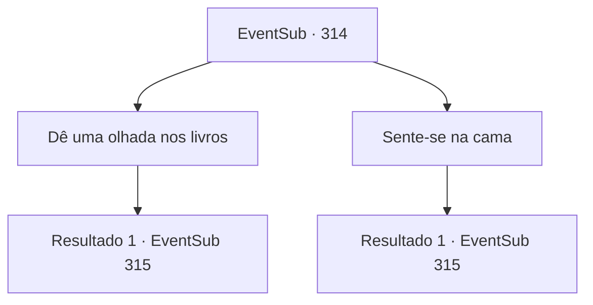

# Eventos secundários · 314

[Índice da tabela](index.md) · [Índice geral](../index.md)

ID: `pt:EventSub:314` · Fonte: `EventSub4` · Versão: 1.2.47.

Mapeamento estático dos arquivos; a disponibilidade e a execução dependem do estado da run.

## Texto do evento

*Sem texto no arquivo.*

## Dados de entrada

```json
{
  "id": 314,
  "grade": 1,
  "subEvent": "",
  "required": ""
}
```

## Mapa das escolhas



## Escolhas e resultados

### Escolha 1

Dê uma olhada nos livros

Requisitos e outros campos da escolha:

```json
{
  "required": ""
}
```

#### Resultado 1.1

À medida que você começa a olhar os livros na prateleira, Cira se aproxima de você por trás e se aproxima. Ela toca lentamente seus ombros e fala. 

 "Hngh... Então os livros são o que chamaram sua atenção...? Depois de ter vindo até aqui...?"

 Ela agarra seus braços, vira você e continua. 

 "Você é tão burro assim, ou isso é uma recusa firme?"

 Cira empurra seu rosto próximo ao seu, dizendo que se você não deixar claro para ela, ela vai fazer o que quiser com você.

Continuação registrada: [Evento 315](0315.md) na mesma tabela.

```json
{
  "required": "",
  "chance": "1",
  "nextEvent": 315,
  "type": 2,
  "reward": ""
}
```

### Escolha 2

Sente-se na cama

Requisitos e outros campos da escolha:

```json
{
  "required": ""
}
```

#### Resultado 2.1

Você se senta na cama. Cira segue, sentando-se ao seu lado. Ela então coloca os braços ao redor da sua cintura. 

 "Eu... vou ultrapassar a linha agora. Eu quero ter você só para mim... Vou fazer o que eu quiser com você agora. Se você quiser continuar como amigo, essa é a única chance."

 O rosto dela está tão próximo ao seu, que você consegue até ver seu rosto refletido nos olhos dela.

Continuação registrada: [Evento 315](0315.md) na mesma tabela.

```json
{
  "required": "",
  "chance": "1",
  "nextEvent": 315,
  "type": 2,
  "reward": ""
}
```

## Referências que chegam a este evento

- [Evento 176 · escolha 1 · resultado 1](0176.md#escolha-1)
