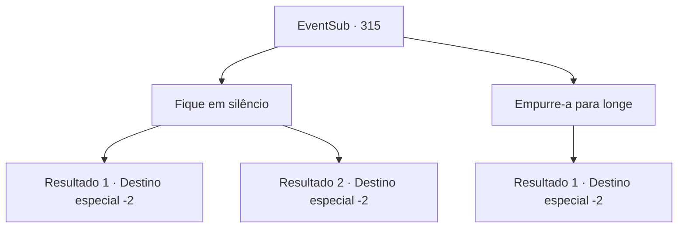

# Eventos secundários · 315

[Índice da tabela](index.md) · [Índice geral](../index.md)

ID: `pt:EventSub:315` · Fonte: `EventSub4` · Versão: 1.2.47.

Mapeamento estático dos arquivos; a disponibilidade e a execução dependem do estado da run.

## Texto do evento

*Sem texto no arquivo.*

## Dados de entrada

```json
{
  "id": 315,
  "grade": 1,
  "subEvent": "",
  "required": ""
}
```

## Mapa das escolhas



## Escolhas e resultados

### Escolha 1

Fique em silêncio

Requisitos e outros campos da escolha:

```json
{
  "required": "24_1_1"
}
```

#### Resultado 1.1

Cira responde com um sorriso. É uma face que uma criança faria, quando vê uma panqueca bem cozida. Ela coloca os lábios nos seus. Depois de um beijo feroz, ela lambe os lábios novamente e fala. <color=#F781BE>

 "Huhuhu.... eu ainda nem comecei. Venha aqui, você ..."

</color> Você nem sabe quanto tempo passou. Você sente que seu corpo está saturado de suor. Cira parece um pouco cansado também. Ela fala, respirando longos. 

 "*Pant**Pant*.... caramba, você tem muita resistência ...! Eu me diverti. Uh ... eu sinto que deveria ter feito isso antes ... mas espere."

 Ela puxa algo de um travesseiro. Ela entrega a você. Quando você abre a mão, você vê uma pulseira decorada com uma jóia vermelha. 

 "Isso significa que você é meu agora. Você não pode sem minha permissão de agora em diante, entendeu?"

 Ela também lhe entrega uma poção. Você se despediu dela e sai.

Continuação registrada: [Destino especial `-2`](../destinos-especiais.md).

```json
{
  "required": "",
  "chance": "1|0_13_1",
  "nextEvent": -2,
  "type": 0,
  "reward": "3_235_1|3_36_1|12_5_-1|5_294_1|14_5_5"
}
```

#### Resultado 1.2

Cira responde com um sorriso. É uma face que uma criança faria, quando vê uma panqueca bem cozida. Ela coloca os lábios nos seus. Depois de um beijo feroz, ela lambe os lábios novamente e fala. <color=#F781BE>

 "Huhuhu.... eu ainda nem comecei. Venha aqui, você ..."

</color> Você nem sabe quanto tempo passou. Você está drenado da sua energia, como uma toalha molhada. Cira ri maliciosamente e derrama poção em sua boca. 

 "Teehee ..! Eu me diverti. Uh ... eu sinto que deveria ter feito isso antes ... mas espere."

 Ela puxa algo de um travesseiro. Ela entrega a você. Quando você abre a mão, você vê uma pulseira decorada com uma jóia vermelha. 

 "Isso significa que você é meu agora. Você não pode sem minha permissão de agora em diante, entendeu?"

 Ela também lhe entrega uma poção. Você se despediu dela e sai.

Continuação registrada: [Destino especial `-2`](../destinos-especiais.md).

```json
{
  "required": "",
  "chance": "15",
  "nextEvent": -2,
  "type": 1,
  "reward": "3_235_1|12_5_-1|14_5_5|5_294_1"
}
```

### Escolha 2

Empurre-a para longe

Requisitos e outros campos da escolha:

```json
{
  "required": ""
}
```

#### Resultado 2.1

Você gentilmente a empurrou para longe. Cira assente em resposta, decepcionantemente. 

 "Hum ... tudo bem. Então, pelo menos, tome uma bebida comigo."

 Cira levanta -se da cama e cabe para um gabinete. Ela traz duas garrafas de rum e entrega a uma. 

 "Aqui, vamos beber."

 Depois de terminar, Cira começa a beber a garrafa. Você faz o possível para acompanhá -la, sentado ao lado dela. 

 No dia seguinte, você acorda com uma forte dor de cabeça, provavelmente da ressaca. Cira parece estar dormindo, com as costas voltadas para você. Você não tem certeza se ela está realmente dormindo ou fingindo ser, mas você sai da caverna dela.

Continuação registrada: [Destino especial `-2`](../destinos-especiais.md).

```json
{
  "required": "",
  "chance": "1",
  "nextEvent": -2,
  "type": 2,
  "reward": "12_5_-1|14_5_0"
}
```

## Referências que chegam a este evento

- [Evento 314 · escolha 1 · resultado 1](0314.md#escolha-1)
- [Evento 314 · escolha 2 · resultado 1](0314.md#escolha-2)
