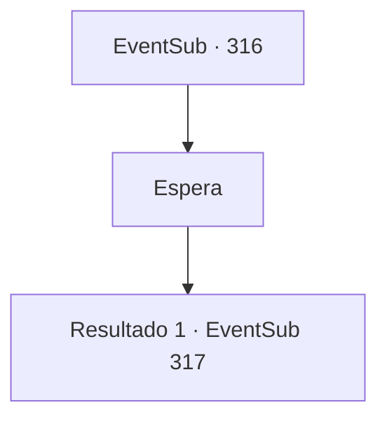

# Eventos secundários · 316

[Índice da tabela](index.md) · [Índice geral](../index.md)

ID: `pt:EventSub:316` · Fonte: `EventSub4` · Versão: 1.2.47.

Mapeamento estático dos arquivos; a disponibilidade e a execução dependem do estado da run.

## Texto do evento

*Sem texto no arquivo.*

## Dados de entrada

```json
{
  "id": 316,
  "grade": 1,
  "subEvent": "",
  "required": ""
}
```

## Mapa das escolhas



## Escolhas e resultados

### Escolha 1

Espera

Requisitos e outros campos da escolha:

```json
{
  "required": ""
}
```

#### Resultado 1.1

Você espera por um tempo e logo Cira abre os olhos com um gemido. Ela verifica seu corpo e fica surpresa. Ela também toca a testa e percebe que seus chifres também desapareceram. 

 "...O que aconteceu...?"

 Você diz a ela que purificou o sangue do demônio dentro dela. Ela segura suas mãos e continua. 

 "...Sinto como se... tivesse renascido, ou algo assim. Muito obrigada... Eu... devo ser capaz de viver como uma garota normal agora, certo?"

 Sua voz falha enquanto ela fica com os olhos marejados. Olhando para você, ela pergunta como pode retribuir o que você fez.

Continuação registrada: [Evento 317](0317.md) na mesma tabela.

```json
{
  "required": "",
  "chance": "1",
  "nextEvent": 317,
  "type": 2,
  "reward": ""
}
```

## Referências que chegam a este evento

- [Evento 156 · escolha 3 · resultado 1](0156.md#escolha-3)
- [Evento 156 · escolha 3 · resultado 2](0156.md#escolha-3)
- [Evento 318 · escolha 1 · resultado 1](0318.md#escolha-1)
