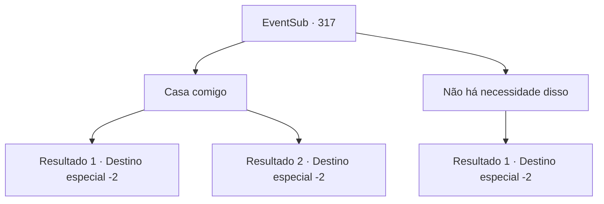

# Eventos secundários · 317

[Índice da tabela](index.md) · [Índice geral](../index.md)

ID: `pt:EventSub:317` · Fonte: `EventSub4` · Versão: 1.2.47.

Mapeamento estático dos arquivos; a disponibilidade e a execução dependem do estado da run.

## Texto do evento

*Sem texto no arquivo.*

## Dados de entrada

```json
{
  "id": 317,
  "grade": 1,
  "subEvent": "",
  "required": ""
}
```

## Mapa das escolhas



## Escolhas e resultados

### Escolha 1

Casa comigo

Requisitos e outros campos da escolha:

```json
{
  "required": "24_1_1"
}
```

#### Resultado 1.1

Cira responde com uma expressão séria. 

 "Uh... você estava literalmente tentando me matar não faz muito tempo."

 Mas então, ela sorri e se aproxima de você. 

 "Tanto faz. Provavelmente você quis dizer que queria matar o demônio dentro de mim. Mas... eu ainda não sei muito sobre você."

 Após hesitar brevemente, Cira continua. 

 "Ah, sim. Venha para 'Mariposa'. Estarei esperando."

 Ela sai depois de terminar.

Continuação registrada: [Destino especial `-2`](../destinos-especiais.md).

```json
{
  "required": "5_293_1",
  "chance": "1",
  "nextEvent": -2,
  "type": 2,
  "reward": "12_5_11"
}
```

#### Resultado 1.2

Cira responde com uma expressão séria. 

 "Hm... Então você já se apaixonou por mim, né? Droga, é cansativo, na verdade. Ser tão bonita."

 Depois de murmurar para si mesma de forma travessa, ela explode em risos e continua. 

 "Mas... Ainda não sei muito sobre você."

 Depois de hesitar brevemente, Cira continua. 

 "Ah, sim. Venha para 'Mariposa'. Estarei esperando."

 Ela sai depois de terminar.

Continuação registrada: [Destino especial `-2`](../destinos-especiais.md).

```json
{
  "required": "18_293_1",
  "chance": "1",
  "nextEvent": -2,
  "type": 2,
  "reward": "12_5_11"
}
```

### Escolha 2

Não há necessidade disso

Requisitos e outros campos da escolha:

```json
{
  "required": ""
}
```

#### Resultado 2.1

Você diz a Cira que na verdade não quer nada. Ela balança a cabeça em resposta e responde. 

 "Uh-uh. Não suporto ficar em dívida. Preciso te retribuir de alguma forma. Se tiver tempo, venha para 'Mariposa'. Estarei esperando."

 Ela insiste para que você visite, enquanto se afasta.

Continuação registrada: [Destino especial `-2`](../destinos-especiais.md).

```json
{
  "required": "",
  "chance": "1",
  "nextEvent": -2,
  "type": 2,
  "reward": "12_5_12"
}
```

## Referências que chegam a este evento

- [Evento 316 · escolha 1 · resultado 1](0316.md#escolha-1)
