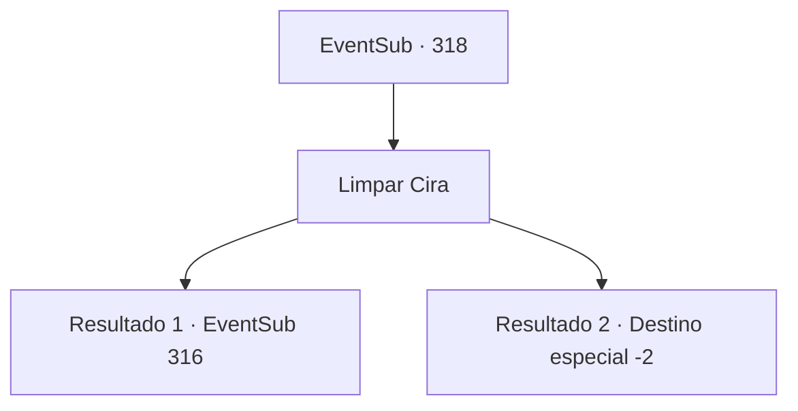

# Eventos secundários · 318

[Índice da tabela](index.md) · [Índice geral](../index.md)

ID: `pt:EventSub:318` · Fonte: `EventSub4` · Versão: 1.2.47.

Mapeamento estático dos arquivos; a disponibilidade e a execução dependem do estado da run.

## Texto do evento

*Sem texto no arquivo.*

## Dados de entrada

```json
{
  "id": 318,
  "grade": 1,
  "subEvent": "",
  "required": ""
}
```

## Mapa das escolhas



## Escolhas e resultados

### Escolha 1

Limpar Cira

Requisitos e outros campos da escolha:

```json
{
  "required": ""
}
```

#### Resultado 1.1

Você rapidamente desenha um círculo de vedação. Você então canaliza o poder sagrado no corpo de Cira. Ela joga a cabeça para trás e grita de dor, enquanto uma substância espessa e vermelha enevoada sai de seus olhos, nariz e boca. <link=shake><color=red>

 "AAAAAAARRRRGHHHHH!!!!!"

</color></link> Sua armadura se quebra em pedaços quando seu grito chega ao fim. Depois de um tempo, a substância vermelha se dissipa e você pode ver Cira novamente. A armadura vermelha, as garras e chifres afiados, todos eles se foram. Cira agora é uma mulher perfeitamente normal, deitada no chão como se exausta.  Depois de testemunhar isso, Rohan murmura para si mesmo, surpreso. 

 "Pelos divinos ... você realmente fez isso. Isto é incrível! Você nos fez um ótimo serviço."

 Ele faz uma oração e depois diz que seus colegas templários da Ordem limparão o local. 

 "Como demonstração de apreciação, em breve você será suficientemente recompensado."

 Você pega Cira e sai da caverna com Rohan. Rohan sai imediatamente, e você fica com Cira, que ainda está inconsciente.

Continuação registrada: [Evento 316](0316.md) na mesma tabela.

```json
{
  "required": "",
  "chance": "1|0_7_1",
  "nextEvent": 316,
  "type": 0,
  "reward": "5_295_1|22_3_-2"
}
```

#### Resultado 1.2

Você rapidamente desenha um círculo de vedação. Você então canaliza o poder sagrado no corpo de Cira. Ela joga a cabeça para trás e grita de dor, enquanto uma substância espessa e vermelha enevoada sai de seus olhos, nariz e boca. <link=shake><color=red>

 "AAAAAAARRRRGHHHHH!!!!!"

</color></link> Você se sente escurecendo, pois uma dor de cabeça que quebra o cérebro é sentida. Rohan o empurra para longe e puxa sua espada. Essa é a última coisa que você vê antes de ficar inconsciente. 

 Depois de muito tempo se passaram, você acorda com uma dor de cabeça ardente. Na sua frente está Rohan, segurando uma espada. Ele se aproxima de você, ajuda você e fala. 

 "... você se saiu bem. Você fez tudo o que pôde. Como demonstração de apreciação, você em breve será suficientemente recompensado."

 Ele faz uma oração e diz que seus colegas templários da Ordem limparão o local. Você diz adeus a Rohan e sai da caverna.

Continuação registrada: [Destino especial `-2`](../destinos-especiais.md).

```json
{
  "required": "",
  "chance": "17",
  "nextEvent": -2,
  "type": 1,
  "reward": "12_5_9|22_3_-2"
}
```

## Referências que chegam a este evento

- [Evento 158 · escolha 3 · resultado 2](0158.md#escolha-3)
