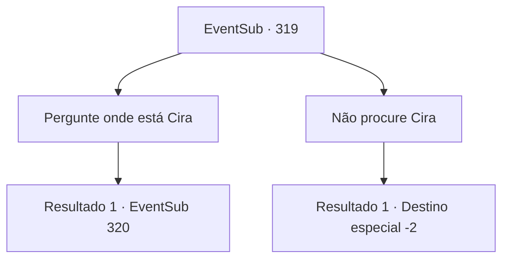

# Eventos secundários · 319

[Índice da tabela](index.md) · [Índice geral](../index.md)

ID: `pt:EventSub:319` · Fonte: `EventSub4` · Versão: 1.2.47.

Mapeamento estático dos arquivos; a disponibilidade e a execução dependem do estado da run.

## Texto do evento

Como prometido, você visita a cidade 'Mariposa'. Pelo que você ouve, a cidade é famosa pelas lindas flores e borboletas. Assim que você entra nos portões da cidade, você pode sentir o aroma das flores. Você segue o campo de flores até a praça da cidade. A grande praça redonda está ocupada por uma igreja e uma fonte, crianças pequenas se divertindo e alguns velhos sentados ao redor deles, conversando.

## Dados de entrada

```json
{
  "id": 319,
  "grade": 3,
  "subEvent": "",
  "required": "12_5_11|24_1_1"
}
```

## Mapa das escolhas



## Escolhas e resultados

### Escolha 1

Pergunte onde está Cira

Requisitos e outros campos da escolha:

```json
{
  "required": ""
}
```

#### Resultado 1.1

Você se aproxima das pessoas perto da fonte e pergunta a elas onde a mulher de olhos diferentes com cabelo vermelho pode ser encontrada. Então, um menino jovem responde com uma voz ativa. 

 "Oh! Ela mora bem... ali!"

 Ele está apontando para uma pequena casa localizada diretamente em frente à igreja, apenas distanciada pela praça da cidade. Enquanto você está prestes a ir para a casa de Cira depois de agradecer ao menino, um homem idoso ao lado da fonte fala. 

 "Aquela vadia... é perigosa..."


Continuação registrada: [Evento 320](0320.md) na mesma tabela.

```json
{
  "required": "",
  "chance": "1",
  "nextEvent": 320,
  "type": 2,
  "reward": ""
}
```

### Escolha 2

Não procure Cira

Requisitos e outros campos da escolha:

```json
{
  "required": ""
}
```

#### Resultado 2.1

Você olha fixamente para os portões da cidade por um tempo antes de se virar e sair.

Continuação registrada: [Destino especial `-2`](../destinos-especiais.md).

```json
{
  "required": "",
  "chance": "1",
  "nextEvent": -2,
  "type": 2,
  "reward": "12_5_-1|14_5_6"
}
```

## Referências que chegam a este evento

Nenhum `nextEvent` positivo da mesma tabela aponta para este nó. Isso não prova que seja inacessível: sorteio e estado de história podem selecioná-lo.

