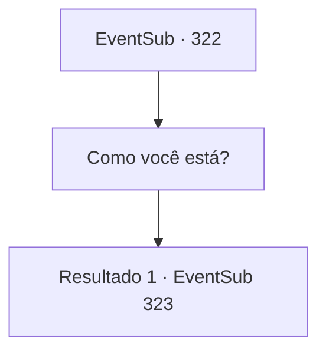

# Eventos secundários · 322

[Índice da tabela](index.md) · [Índice geral](../index.md)

ID: `pt:EventSub:322` · Fonte: `EventSub4` · Versão: 1.2.47.

Mapeamento estático dos arquivos; a disponibilidade e a execução dependem do estado da run.

## Texto do evento

*Sem texto no arquivo.*

## Dados de entrada

```json
{
  "id": 322,
  "grade": 1,
  "subEvent": "",
  "required": ""
}
```

## Mapa das escolhas



## Escolhas e resultados

### Escolha 1

Como você está?

Requisitos e outros campos da escolha:

```json
{
  "required": ""
}
```

#### Resultado 1.1

Cira leva você para dentro de sua casa e responde. 

 "Não poderia me sentir melhor. Estou aproveitando ao máximo, na verdade. A cidade é linda e as pessoas são simpáticas. Ao contrário do que era antes."

 Ela pede para você esperar na mesa. Ela retorna com uma jarra de chá, com uma pétala amarela em cima.

Continuação registrada: [Evento 323](0323.md) na mesma tabela.

```json
{
  "required": "",
  "chance": "1",
  "nextEvent": 323,
  "type": 2,
  "reward": ""
}
```

## Referências que chegam a este evento

- [Evento 320 · escolha 2 · resultado 1](0320.md#escolha-2)
- [Evento 321 · escolha 1 · resultado 1](0321.md#escolha-1)
- [Evento 321 · escolha 2 · resultado 1](0321.md#escolha-2)
