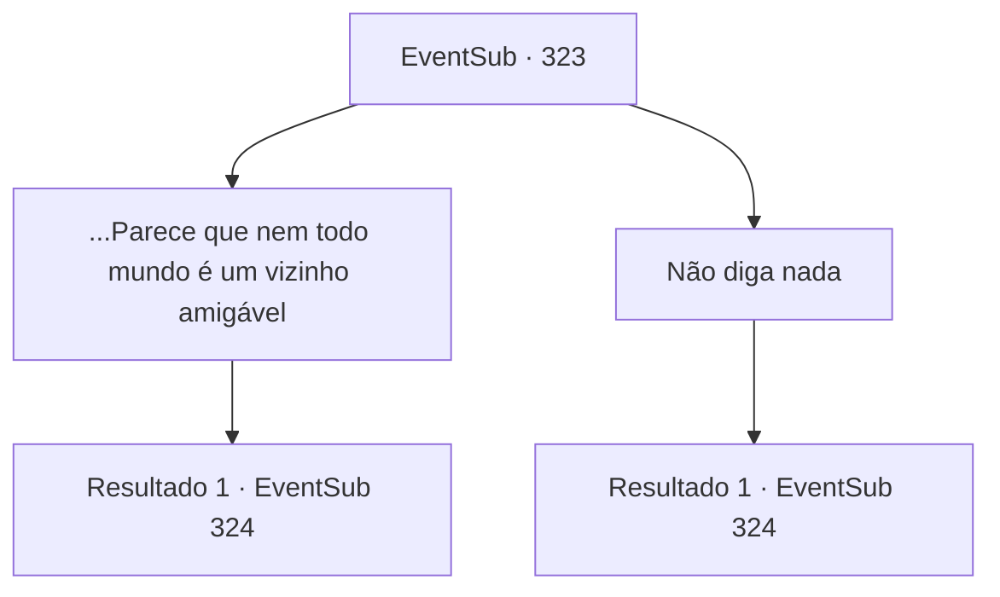

# Eventos secundários · 323

[Índice da tabela](index.md) · [Índice geral](../index.md)

ID: `pt:EventSub:323` · Fonte: `EventSub4` · Versão: 1.2.47.

Mapeamento estático dos arquivos; a disponibilidade e a execução dependem do estado da run.

## Texto do evento

*Sem texto no arquivo.*

## Dados de entrada

```json
{
  "id": 323,
  "grade": 1,
  "subEvent": "",
  "required": ""
}
```

## Mapa das escolhas



## Escolhas e resultados

### Escolha 1

...Parece que nem todo mundo é um vizinho amigável

Requisitos e outros campos da escolha:

```json
{
  "required": "5_315_1"
}
```

#### Resultado 1.1

Cira responde tomando um gole de seu chá de pétalas. 

 "Bem... Existem algumas pessoas que me amaldiçoam ou apontam o dedo para mim. Mas ei, você não pode ser amado por todos, onde quer que vá. E... é muito menos difícil para mim em comparação quando eu era pequena."

 Ela sorri amargamente, murmurando para si mesma, que pelo menos ninguém está jogando pedras nela. Ela coloca sua xícara de chá na mesa e continua. 

 "Você me acompanharia por um segundo?"

 Você é guiado por Cira para fora da casa. A praça da cidade ainda está cheia de crianças brincando. A luz do sol quente as banha. Cira olha para a praça e fala. 

 "Agora... você vai brincar de imaginação. Você é uma criança pequena com chifres. Seus olhos têm cores diferentes também. Você encontra um grupo de crianças da sua idade, se divertindo ao redor da fonte. Você quer se juntar a eles. O que você faz?"


Continuação registrada: [Evento 324](0324.md) na mesma tabela.

```json
{
  "required": "",
  "chance": "1",
  "nextEvent": 324,
  "type": 2,
  "reward": "5_315_2"
}
```

### Escolha 2

Não diga nada

Requisitos e outros campos da escolha:

```json
{
  "required": ""
}
```

#### Resultado 2.1

Cira coloca uma xícara de chá de pétalas na sua frente. Ela dá um gole em sua xícara de chá de pétalas e fala. 

 "Você me acompanha por um segundo?"

 Você é guiado por Cira para fora da casa. A praça da cidade ainda está cheia de crianças brincando. A luz do sol quente as banha. Cira olha para a praça e fala. 

 "Agora... você vai brincar de imaginação. Você é uma criança pequena com chifres. Seus olhos também têm cores diferentes. Você encontra um grupo de crianças da sua idade, se divertindo ao redor da fonte. Você quer se juntar a eles. O que você faz?"


Continuação registrada: [Evento 324](0324.md) na mesma tabela.

```json
{
  "required": "",
  "chance": "1",
  "nextEvent": 324,
  "type": 2,
  "reward": ""
}
```

## Referências que chegam a este evento

- [Evento 322 · escolha 1 · resultado 1](0322.md#escolha-1)
