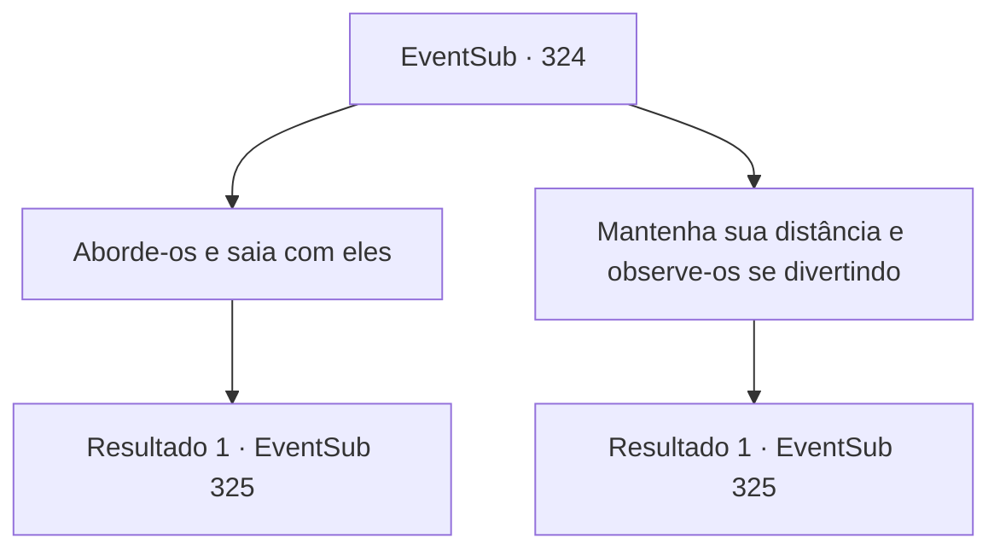

# Eventos secundários · 324

[Índice da tabela](index.md) · [Índice geral](../index.md)

ID: `pt:EventSub:324` · Fonte: `EventSub4` · Versão: 1.2.47.

Mapeamento estático dos arquivos; a disponibilidade e a execução dependem do estado da run.

## Texto do evento

*Sem texto no arquivo.*

## Dados de entrada

```json
{
  "id": 324,
  "grade": 1,
  "subEvent": "",
  "required": ""
}
```

## Mapa das escolhas



## Escolhas e resultados

### Escolha 1

Aborde-os e saia com eles

Requisitos e outros campos da escolha:

```json
{
  "required": ""
}
```

#### Resultado 1.1

Ouvindo sua resposta, Cira coloca um sorriso fraco e continua. 

 "As crianças parecem curiosas sobre você. Mas droga! Seus pais se aproximam delas e dizem algo a elas. 'Não brinquem com ela, ela é um demônio! Se vocês brincarem com aquela criança, irão para o inferno quando morrerem!' ...Infelizmente, você fica sozinho."

 Então ela pega sua mão e vai para outro lugar. Ela te leva até uma ponte, construída sobre um lago estreito. Então ela olha para o fundo da ponte e fala. 

 "Agora, imagine a mesma garota com chifres, mas um pouco mais velha. Agora... você encontra um menino, cercado por um grupo de crianças. Parece que ele está sendo intimidado! O menino parece estar aterrorizado. O que você faz?"


Continuação registrada: [Evento 325](0325.md) na mesma tabela.

```json
{
  "required": "",
  "chance": "1",
  "nextEvent": 325,
  "type": 2,
  "reward": "5_316_1"
}
```

### Escolha 2

Mantenha sua distância e observe-os se divertindo

Requisitos e outros campos da escolha:

```json
{
  "required": ""
}
```

#### Resultado 2.1

Ouvindo sua resposta, Cira toca seu queixo com as mãos e responde. 

 "Hm... a resposta seria... 'As crianças se divertiram, sem prestar nenhuma atenção em você.'"

 Ela então pega sua mão e leva você para outro lugar. Ela te leva até uma ponte, construída sobre um lago estreito. Ela então olha para o fundo da ponte e fala. 

 "Agora, imagine a mesma garota de chifres, mas um pouco mais velha. Agora... você encontra um menino, cercado por um grupo de crianças. Parece que ele está sendo intimidado! O menino parece estar aterrorizado. O que você faz?"


Continuação registrada: [Evento 325](0325.md) na mesma tabela.

```json
{
  "required": "",
  "chance": "1",
  "nextEvent": 325,
  "type": 2,
  "reward": "5_316_0"
}
```

## Referências que chegam a este evento

- [Evento 323 · escolha 1 · resultado 1](0323.md#escolha-1)
- [Evento 323 · escolha 2 · resultado 1](0323.md#escolha-2)
