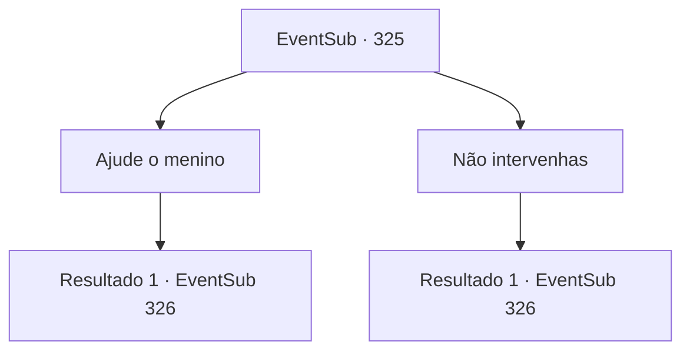

# Eventos secundários · 325

[Índice da tabela](index.md) · [Índice geral](../index.md)

ID: `pt:EventSub:325` · Fonte: `EventSub4` · Versão: 1.2.47.

Mapeamento estático dos arquivos; a disponibilidade e a execução dependem do estado da run.

## Texto do evento

*Sem texto no arquivo.*

## Dados de entrada

```json
{
  "id": 325,
  "grade": 1,
  "subEvent": "",
  "required": ""
}
```

## Mapa das escolhas



## Escolhas e resultados

### Escolha 1

Ajude o menino

Requisitos e outros campos da escolha:

```json
{
  "required": ""
}
```

#### Resultado 1.1

Cira dá de ombros em resposta. 

 "Você bateu nos valentões. Em seguida, se aproxima do garoto que estava sendo intimidado para ajudá-lo. Mas oh, ele te chama de 'monstro' e foge~."

 Ela finge ser engraçada e então te encara em silêncio.

Continuação registrada: [Evento 326](0326.md) na mesma tabela.

```json
{
  "required": "",
  "chance": "1",
  "nextEvent": 326,
  "type": 2,
  "reward": "5_317_1"
}
```

### Escolha 2

Não intervenhas

Requisitos e outros campos da escolha:

```json
{
  "required": ""
}
```

#### Resultado 2.1

Ouvindo sua resposta, Cira toca seu queixo com as mãos e responde. 

 "A resposta provavelmente seria... 'Os valentões continuaram a bater no menino, cercando-o'."

 Em seguida, ela olha para você em silêncio.

Continuação registrada: [Evento 326](0326.md) na mesma tabela.

```json
{
  "required": "",
  "chance": "1",
  "nextEvent": 326,
  "type": 2,
  "reward": "5_317_0"
}
```

## Referências que chegam a este evento

- [Evento 324 · escolha 1 · resultado 1](0324.md#escolha-1)
- [Evento 324 · escolha 2 · resultado 1](0324.md#escolha-2)
