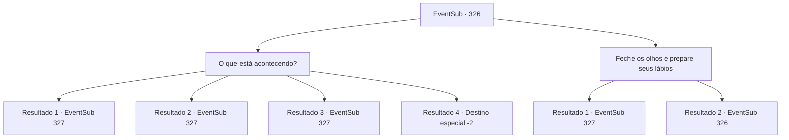

# Eventos secundários · 326

[Índice da tabela](index.md) · [Índice geral](../index.md)

ID: `pt:EventSub:326` · Fonte: `EventSub4` · Versão: 1.2.47.

Mapeamento estático dos arquivos; a disponibilidade e a execução dependem do estado da run.

## Texto do evento

*Sem texto no arquivo.*

## Dados de entrada

```json
{
  "id": 326,
  "grade": 1,
  "subEvent": "",
  "required": ""
}
```

## Mapa das escolhas



## Escolhas e resultados

### Escolha 1

O que está acontecendo?

Requisitos e outros campos da escolha:

```json
{
  "required": ""
}
```

#### Resultado 1.1


 "Você passou!"

 Depois de dizer isso, Cira rapidamente acrescenta, antes que você possa responder. 

 "Eu... sempre quis estar junto com outras pessoas. Tipo, pessoas normais. Eu não conseguia até agora, mas graças a você... acho que posso fazer isso."

 Ela se apoia na ponte e continua. 

 "Este lugar está... cheio de más lembranças para mim, mas com você, acho que posso enfrentá-las e cobri-las com memórias felizes e empolgantes."

 Após terminar, Cira estende a mão para você, colocando os dedos bem na sua frente.

Continuação registrada: [Evento 327](0327.md) na mesma tabela.

```json
{
  "required": "5_316_1|5_317_1",
  "chance": "1",
  "nextEvent": 327,
  "type": 2,
  "reward": ""
}
```

#### Resultado 1.2


 "Um pouco decepcionante... mas ainda está tudo bem."

 Depois de dizer isso, Cira acrescenta rapidamente, antes que você possa responder. 

 "Eu... sempre quis estar junto com outras pessoas. Tipo, pessoas normais. Eu não conseguia até agora, mas graças a você... acho que posso fazer isso."

 Ela se apoia na ponte e continua. 

 "Este lugar está cheio de más lembranças para mim, mas com você, acho que posso enfrentá-las e cobri-las com memórias felizes e empolgantes."

 Após terminar, Cira estende a mão para você, colocando os dedos bem na sua frente.

Continuação registrada: [Evento 327](0327.md) na mesma tabela.

```json
{
  "required": "5_316_1|18_317_1",
  "chance": "1",
  "nextEvent": 327,
  "type": 2,
  "reward": ""
}
```

#### Resultado 1.3


 "Um pouco decepcionante... mas ainda está tudo bem."

 Depois de dizer isso, Cira rapidamente acrescenta, antes que você possa responder. 

 "Eu... sempre quis estar junto com outras pessoas. Tipo, pessoas normais. Eu não conseguia até agora, mas graças a você... acho que posso fazer isso."

 Ela se apoia na ponte e continua. 

 "Este lugar está cheio de más lembranças para mim, mas com você, acho que posso enfrentá-las e cobri-las com memórias felizes e empolgantes."

 Após terminar, Cira estende a mão para você, colocando os dedos bem na sua frente.

Continuação registrada: [Evento 327](0327.md) na mesma tabela.

```json
{
  "required": "5_317_1|18_316_1",
  "chance": "1",
  "nextEvent": 327,
  "type": 2,
  "reward": ""
}
```

#### Resultado 1.4


 "Eu... sempre quis estar junto com outras pessoas. Como pessoas normais. Eu não conseguia até agora, mas graças a você... acho que posso fazer isso."

 Ela se apoia na ponte e continua. 

 "Mas... suas respostas negam todos os meus esforços diretamente. Sinto muito dizer isso, mas não acredito que possamos ficar juntos."

 Após terminar, Cira lhe entrega uma bolsa cheia de ouro. Ela então se afasta, dizendo que é o mínimo que pode lhe dar, por tê-la ajudado.

Continuação registrada: [Destino especial `-2`](../destinos-especiais.md).

```json
{
  "required": "18_317_1|18_316_1",
  "chance": "1",
  "nextEvent": -2,
  "type": 2,
  "reward": "0_4_50|12_5_-1|14_5_6"
}
```

### Escolha 2

Feche os olhos e prepare seus lábios

Requisitos e outros campos da escolha:

```json
{
  "required": "5_314_0"
}
```

#### Resultado 2.1

Você encara os olhos de Cira, antes de fechar os seus e preparar seus lábios. Você definitivamente acha que agora é a hora de um beijo. 

 "Pfft....!!"

 Cira explode em risadas e então te beija. Ela continua. 

 "Vamos nos casar. Você e eu. Não há necessidade de prolongar isso, suponho. Eu poderia fazer qualquer coisa com você."

 Cira estende a mão na sua frente, como se estivesse pedindo um anel.

Continuação registrada: [Evento 327](0327.md) na mesma tabela.

```json
{
  "required": "5_316_1|5_317_1",
  "chance": "1",
  "nextEvent": 327,
  "type": 2,
  "reward": ""
}
```

#### Resultado 2.2

Você encara os olhos de Cira, antes de fechar os seus e preparar seus lábios. Você definitivamente acha que agora é a hora de um beijo. Mas... 

 "Uh-uh. Agora não é a hora!"

 Cira empurra seus lábios para longe com os dedos.

Continuação registrada: [Evento 326](0326.md) na mesma tabela.

```json
{
  "required": "-1|18_317_1|18_316_1",
  "chance": "1",
  "nextEvent": 326,
  "type": 2,
  "reward": "5_314_1"
}
```

## Referências que chegam a este evento

- [Evento 325 · escolha 1 · resultado 1](0325.md#escolha-1)
- [Evento 325 · escolha 2 · resultado 1](0325.md#escolha-2)
- [Evento 326 · escolha 2 · resultado 2](0326.md#escolha-2)
