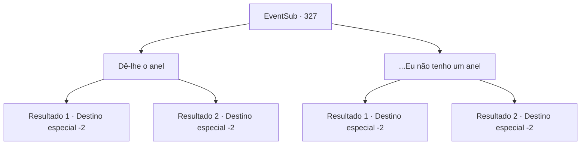

# Eventos secundários · 327

[Índice da tabela](index.md) · [Índice geral](../index.md)

ID: `pt:EventSub:327` · Fonte: `EventSub4` · Versão: 1.2.47.

Mapeamento estático dos arquivos; a disponibilidade e a execução dependem do estado da run.

## Texto do evento

*Sem texto no arquivo.*

## Dados de entrada

```json
{
  "id": 327,
  "grade": 1,
  "subEvent": "",
  "required": ""
}
```

## Mapa das escolhas



## Escolhas e resultados

### Escolha 1

Dê-lhe o anel

Requisitos e outros campos da escolha:

```json
{
  "required": "8_46_1"
}
```

#### Resultado 1.1

Cira coloca o anel que você deu a ela em seu dedo anelar. Ela então olha para ele satisfeita. Ela então te abraça apertado e continua. 

 "Huhu.... Eu estarei esperando. Quando suas aventuras terminarem, você deve voltar aqui, está bem? Se você ousar me tornar uma viúva... eu te matarei."

 Você dá tapinhas nas costas dela, promete que irá voltar e sai de Mariposa.

Continuação registrada: [Destino especial `-2`](../destinos-especiais.md).

```json
{
  "required": "18_976_1",
  "chance": "1",
  "nextEvent": -2,
  "type": 2,
  "reward": "4_46_1|0_1_1|12_5_-1|14_5_7|5_294_1"
}
```

#### Resultado 1.2

Cira coloca o anel que você deu a ela em seu dedo anelar. Ela então olha para ele satisfeita. Ela então te abraça apertado e continua. 

 "Huhu.... Eu estarei esperando. Quando suas aventuras terminarem, você deve voltar aqui, está bem? Se você ousar me tornar uma viúva... eu te matarei."

 Você dá tapinhas nas costas dela, promete que irá voltar e sai de Mariposa.

Continuação registrada: [Destino especial `-2`](../destinos-especiais.md).

```json
{
  "required": "5_976_1",
  "chance": "1",
  "nextEvent": -2,
  "type": 2,
  "reward": "4_46_1|0_1_1|12_5_-1|14_5_12|5_294_1"
}
```

### Escolha 2

...Eu não tenho um anel

Requisitos e outros campos da escolha:

```json
{
  "required": "10_46_1"
}
```

#### Resultado 2.1

Infelizmente, você não possui um anel. Cira derrama uma lágrima, murmurando para si mesma com uma voz triste. 

 "Ah... meu futuro companheiro é tão desalmado...! O que vai acontecer com o meu casamento...?!"

 Mas então, ela te abraça apertado e continua. 

 "Não importa se você tem um anel ou não. Mas... quando suas aventuras terminarem, você deve voltar aqui, está bem? Se você ousar me tornar uma viúva... eu vou te matar."

 Você dá um tapinha nas costas dela, promete que vai voltar e sai de Mariposa.

Continuação registrada: [Destino especial `-2`](../destinos-especiais.md).

```json
{
  "required": "18_976_1",
  "chance": "1",
  "nextEvent": -2,
  "type": 2,
  "reward": "0_1_1|12_5_-1|14_5_7|5_294_1"
}
```

#### Resultado 2.2

Infelizmente, você não possui um anel. Cira derrama uma lágrima, murmurando para si mesma com uma voz triste. 

 "Ah... meu futuro companheiro é tão desalmado...! O que vai acontecer com o meu casamento...?!"

 Mas então, ela te abraça apertado e continua. 

 "Não importa se você tem um anel ou não. Mas... quando suas aventuras terminarem, você deve voltar aqui, está bem? Se você ousar me tornar uma viúva... eu vou te matar."

 Você dá um tapinha nas costas dela, promete que vai voltar e sai de Mariposa.

Continuação registrada: [Destino especial `-2`](../destinos-especiais.md).

```json
{
  "required": "5_976_1",
  "chance": "1",
  "nextEvent": -2,
  "type": 2,
  "reward": "0_1_1|12_5_-1|14_5_12|5_294_1"
}
```

## Referências que chegam a este evento

- [Evento 326 · escolha 1 · resultado 1](0326.md#escolha-1)
- [Evento 326 · escolha 1 · resultado 2](0326.md#escolha-1)
- [Evento 326 · escolha 1 · resultado 3](0326.md#escolha-1)
- [Evento 326 · escolha 2 · resultado 1](0326.md#escolha-2)
