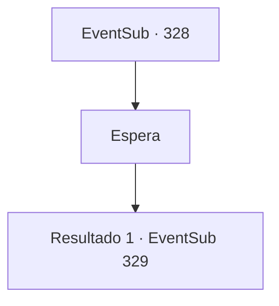

# Eventos secundários · 328

[Índice da tabela](index.md) · [Índice geral](../index.md)

ID: `pt:EventSub:328` · Fonte: `EventSub4` · Versão: 1.2.47.

Mapeamento estático dos arquivos; a disponibilidade e a execução dependem do estado da run.

## Texto do evento

*Sem texto no arquivo.*

## Dados de entrada

```json
{
  "id": 328,
  "grade": 1,
  "subEvent": "",
  "required": ""
}
```

## Mapa das escolhas



## Escolhas e resultados

### Escolha 1

Espera

Requisitos e outros campos da escolha:

```json
{
  "required": ""
}
```

#### Resultado 1.1

Você espera por um tempo e logo Cira abre os olhos com um gemido. Ela verifica seu corpo e fica surpresa. Ela também toca a testa e percebe que seus chifres também desapareceram. 

 "...O que aconteceu...?"

 Você diz a ela que purificou o sangue do demônio dentro dela. Ela segura suas mãos e continua. 

 "O...obrigada... mas..."

 Cira para e olha ao redor. Sua cidade natal, Mariposa, agora é apenas um monte de cinzas. 

 "*suspiro*... O que devo fazer? E...eu...."

 Ela não diz nada, sua voz afogada por suas lágrimas.

Continuação registrada: [Evento 329](0329.md) na mesma tabela.

```json
{
  "required": "",
  "chance": "1",
  "nextEvent": 329,
  "type": 2,
  "reward": ""
}
```

## Referências que chegam a este evento

Nenhum `nextEvent` positivo da mesma tabela aponta para este nó. Isso não prova que seja inacessível: sorteio e estado de história podem selecioná-lo.

