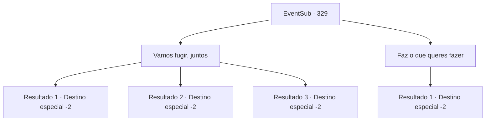

# Eventos secundários · 329

[Índice da tabela](index.md) · [Índice geral](../index.md)

ID: `pt:EventSub:329` · Fonte: `EventSub4` · Versão: 1.2.47.

Mapeamento estático dos arquivos; a disponibilidade e a execução dependem do estado da run.

## Texto do evento

*Sem texto no arquivo.*

## Dados de entrada

```json
{
  "id": 329,
  "grade": 1,
  "subEvent": "",
  "required": ""
}
```

## Mapa das escolhas



## Escolhas e resultados

### Escolha 1

Vamos fugir, juntos

Requisitos e outros campos da escolha:

```json
{
  "required": "24_1_1"
}
```

#### Resultado 1.1

Você sugere que Cira fuja com você e inicie uma vida totalmente nova juntos. Ela olha para você, com olhos chorosos. 

 "Você e eu...? Um novo começo? Quero dizer ... eu abatei tantas pessoas ... vai ficar bem?"

 Você gentilmente consola Cira, dizendo que, se ela ficar aqui, ela definitivamente estará em perigo. Você a ajuda e deixa a cidade arruinada de Mariposa. 

 Você e Cira andam por dias. Vocês dois finalmente conseguem chegar a uma pequena cidade rural sem nome, onde os rumores de Mariposa nunca poderão alcançar. A cidade inteira é composta por cerca de cinco ou seis famílias. Depois de olhar em volta, ela reúne toda sua energia positiva e fala. 

 "Cara. É como, o esconderijo perfeito para um diabo que destruiu uma cidade inteira."

 Ela então se vira, olha para você e diz que ela estará esperando por você aqui. Você a abraça pela última vez antes de deixar a cidade rural.

Continuação registrada: [Destino especial `-2`](../destinos-especiais.md).

```json
{
  "required": "18_976_1",
  "chance": "1|0_12_1",
  "nextEvent": -2,
  "type": 0,
  "reward": "12_5_-1|14_5_8|5_294_1"
}
```

#### Resultado 1.2

Você sugere que Cira fuja com você e comece uma vida completamente nova juntos. Ela olha para você, com os olhos cheios de lágrimas. 

 "Você e eu...? Um novo começo? Quer dizer... Eu matei tantas pessoas..!"

 Ela então balança a cabeça. 

 "Obrigada por se preocupar, mas não posso simplesmente fugir disso. Devo fazer algo, do meu jeito."

 Ela agradece por tê-la tornado humana novamente e lhe entrega um chifre que costumava ser parte do seu corpo. Você deixa Cira sozinha enquanto ela olha para a cidade em ruínas e se afasta de Mariposa.

Continuação registrada: [Destino especial `-2`](../destinos-especiais.md).

```json
{
  "required": "",
  "chance": "15",
  "nextEvent": -2,
  "type": 1,
  "reward": "3_238_1|12_5_-1|14_5_9"
}
```

#### Resultado 1.3

Você sugere que Cira fuja com você e inicie uma vida totalmente nova juntos. Ela olha para você, com olhos chorosos. 

 "Você e eu...? Um novo começo? Quero dizer ... eu abatei tantas pessoas ... vai ficar bem?"

 Você gentilmente consola Cira, dizendo que, se ela ficar aqui, ela definitivamente estará em perigo. Você a ajuda e deixa a cidade arruinada de Mariposa. 

 Você e Cira caminham por dias. Por fim, vocês chegam a 'Alpondes', um pequeno vilarejo dentro do domínio dos Briovichi, onde os rumores de Mariposa jamais poderão alcançar vocês. O vilarejo inteiro é composto por cerca de cinco ou seis famílias. Depois de olhar ao redor, ela reúne toda a sua energia positiva e fala. 

 "Cara. É como, o esconderijo perfeito para um diabo que destruiu uma cidade inteira."

 Então ela se vira, olha para você e diz que vai esperar por você ali. Você a abraça pela última vez antes de deixar o vilarejo do interior.

Continuação registrada: [Destino especial `-2`](../destinos-especiais.md).

```json
{
  "required": "5_976_1",
  "chance": "1|0_12_1",
  "nextEvent": -2,
  "type": 0,
  "reward": "12_5_-1|14_5_12|5_294_1"
}
```

### Escolha 2

Faz o que queres fazer

Requisitos e outros campos da escolha:

```json
{
  "required": ""
}
```

#### Resultado 2.1

As suas palavras parecem ter deixado Cira profundamente preocupada. Após um breve silêncio, ela abre a boca. 

 "...Vou assumir a responsabilidade pelo que fiz. É tudo o que consigo pensar agora."

 Ela agradece por tê-la tornado humana novamente e entrega-lhe um chifre que costumava fazer parte do seu corpo. Você deixa Cira sozinha enquanto ela olha para a cidade em ruínas e se afasta de Mariposa.

Continuação registrada: [Destino especial `-2`](../destinos-especiais.md).

```json
{
  "required": "",
  "chance": "1",
  "nextEvent": -2,
  "type": 2,
  "reward": "3_238_1|12_5_-1|14_5_9"
}
```

## Referências que chegam a este evento

- [Evento 168 · escolha 2 · resultado 1](0168.md#escolha-2)
- [Evento 328 · escolha 1 · resultado 1](0328.md#escolha-1)
