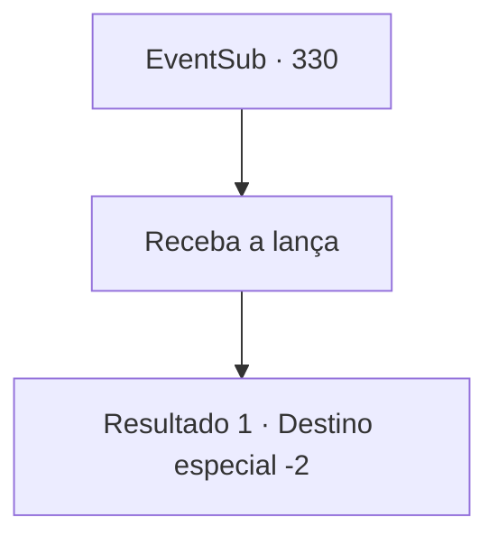

# Eventos secundários · 330

[Índice da tabela](index.md) · [Índice geral](../index.md)

ID: `pt:EventSub:330` · Fonte: `EventSub4` · Versão: 1.2.47.

Mapeamento estático dos arquivos; a disponibilidade e a execução dependem do estado da run.

## Texto do evento

Enquanto você está passando por uma cidade, um padre se aproxima de você e fala com você. 

 "*Uff*...*Uff*.... É {1}, não é?"

 Ele recupera o fôlego antes de lhe entregar algo, coberto de seda. Você percebe que é uma lança branca. 

 "É uma recompensa da igreja. Aqui, Rohan escreveu uma carta para você também. Permita-me ler para você."

 Ele tira um pedaço de papel dos bolsos e começa a ler. 

 "{1}, não podemos agradecer o suficiente por sua cooperação. Nós não poderíamos ter lidado com aquele diabo sem você. Por favor, pegue a recompensa."

   

## Dados de entrada

```json
{
  "id": 330,
  "grade": 1,
  "subEvent": "",
  "required": "5_295_1"
}
```

## Mapa das escolhas



## Escolhas e resultados

### Escolha 1

Receba a lança

Requisitos e outros campos da escolha:

```json
{
  "required": ""
}
```

#### Resultado 1.1

Você recebe a lança branca com prazer. O padre se curva educadamente e se despede de você.

Continuação registrada: [Destino especial `-2`](../destinos-especiais.md).

```json
{
  "required": "",
  "chance": "1",
  "nextEvent": -2,
  "type": 2,
  "reward": "5_295_2|3_60_1"
}
```

## Referências que chegam a este evento

Nenhum `nextEvent` positivo da mesma tabela aponta para este nó. Isso não prova que seja inacessível: sorteio e estado de história podem selecioná-lo.

