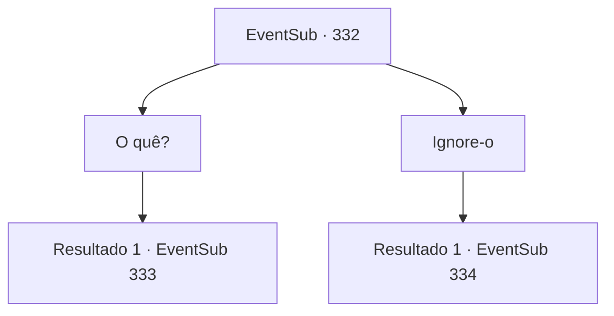

# Eventos secundários · 332

[Índice da tabela](index.md) · [Índice geral](../index.md)

ID: `pt:EventSub:332` · Fonte: `EventSub4` · Versão: 1.2.47.

Mapeamento estático dos arquivos; a disponibilidade e a execução dependem do estado da run.

## Texto do evento

*Sem texto no arquivo.*

## Dados de entrada

```json
{
  "id": 332,
  "grade": 1,
  "subEvent": "",
  "required": ""
}
```

## Mapa das escolhas



## Escolhas e resultados

### Escolha 1

O quê?

Requisitos e outros campos da escolha:

```json
{
  "required": ""
}
```

#### Resultado 1.1

O velho responde com voz trêmula. 

 "Sangue do diabo corre em suas veias...! Ela diz que foi purificada, mas não podemos simplesmente confiar em suas palavras. O senhorio, o sumo sacerdote... todos eles são muito ingênuos!"

 Ele franze a testa e expressa sua reclamação.

Continuação registrada: [Evento 333](0333.md) na mesma tabela.

```json
{
  "required": "",
  "chance": "1",
  "nextEvent": 333,
  "type": 2,
  "reward": "5_315_1"
}
```

### Escolha 2

Ignore-o

Requisitos e outros campos da escolha:

```json
{
  "required": ""
}
```

#### Resultado 2.1

Ignoras o velho e vais diretamente para a casa da Cira. Bates algumas vezes na porta de madeira pintada de amarelo. És recebido com uma voz calorosa que diz 'Bem-vindo', enquanto a porta se abre.

Continuação registrada: [Evento 334](0334.md) na mesma tabela.

```json
{
  "required": "",
  "chance": "1",
  "nextEvent": 334,
  "type": 2,
  "reward": ""
}
```

## Referências que chegam a este evento

- [Evento 331 · escolha 1 · resultado 1](0331.md#escolha-1)
