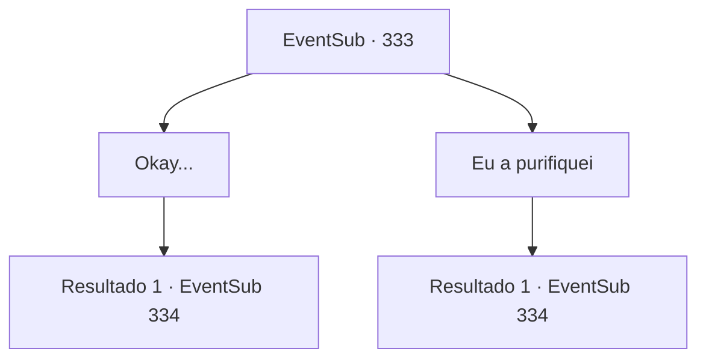

# Eventos secundários · 333

[Índice da tabela](index.md) · [Índice geral](../index.md)

ID: `pt:EventSub:333` · Fonte: `EventSub4` · Versão: 1.2.47.

Mapeamento estático dos arquivos; a disponibilidade e a execução dependem do estado da run.

## Texto do evento

*Sem texto no arquivo.*

## Dados de entrada

```json
{
  "id": 333,
  "grade": 1,
  "subEvent": "",
  "required": ""
}
```

## Mapa das escolhas



## Escolhas e resultados

### Escolha 1

Okay...

Requisitos e outros campos da escolha:

```json
{
  "required": ""
}
```

#### Resultado 1.1

Você mal responde ao velho e vai direto para a casa de Cira. Desta vez, o velho reclama sobre como os jovens são desrespeitosos nos dias de hoje, clicando a língua. Você bate na porta de madeira pintada de amarelo algumas vezes. Você é recebido com uma voz calorosa dizendo 'Bem-vindo', enquanto a porta se abre.

Continuação registrada: [Evento 334](0334.md) na mesma tabela.

```json
{
  "required": "",
  "chance": "1",
  "nextEvent": 334,
  "type": 2,
  "reward": ""
}
```

### Escolha 2

Eu a purifiquei

Requisitos e outros campos da escolha:

```json
{
  "required": ""
}
```

#### Resultado 2.1

Você diz ao velho que você mesmo purificou o sangue demoníaco de Cira. Ele então grita com uma voz ainda mais alta. 

 "Hmph...! Eu nunca vou acreditar em nada a menos que eu veja com meus próprios olhos! Espere e verá! Aquela vadia trará um banho de sangue....!"

 Ele então se afasta da praça, com as mãos cruzadas atrás das costas. Você bate na porta de madeira pintada de amarelo algumas vezes. Você é recebido com uma voz calorosa dizendo 'Bem-vindo', enquanto a porta se abre.

Continuação registrada: [Evento 334](0334.md) na mesma tabela.

```json
{
  "required": "",
  "chance": "1",
  "nextEvent": 334,
  "type": 2,
  "reward": ""
}
```

## Referências que chegam a este evento

- [Evento 332 · escolha 1 · resultado 1](0332.md#escolha-1)
