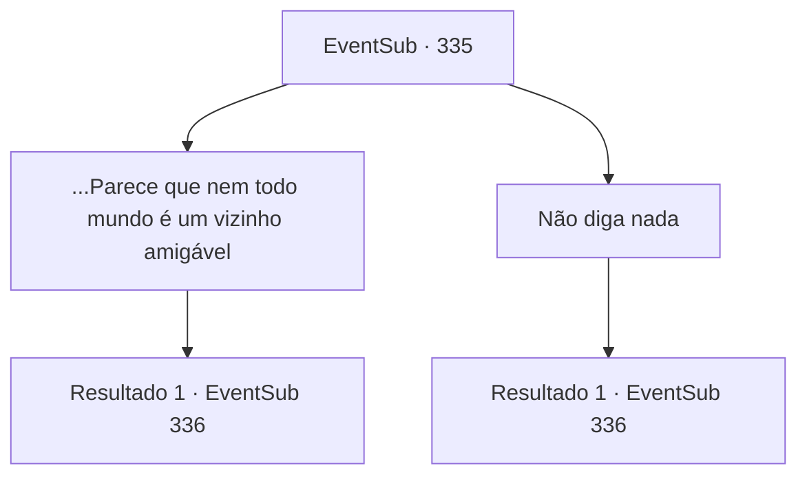

# Eventos secundários · 335

[Índice da tabela](index.md) · [Índice geral](../index.md)

ID: `pt:EventSub:335` · Fonte: `EventSub4` · Versão: 1.2.47.

Mapeamento estático dos arquivos; a disponibilidade e a execução dependem do estado da run.

## Texto do evento

*Sem texto no arquivo.*

## Dados de entrada

```json
{
  "id": 335,
  "grade": 1,
  "subEvent": "",
  "required": ""
}
```

## Mapa das escolhas



## Escolhas e resultados

### Escolha 1

...Parece que nem todo mundo é um vizinho amigável

Requisitos e outros campos da escolha:

```json
{
  "required": "5_315_1"
}
```

#### Resultado 1.1

Cira responde tomando um gole de seu chá de pétalas. 

 "Bem... Há algumas pessoas que me amaldiçoam ou apontam o dedo para mim. Mas ei, você não pode ser amado por todos, onde quer que vá. E... é muito menos difícil para mim em comparação quando eu era pequena."

 Ela sorri amargamente, murmurando para si mesma, que pelo menos ninguém está jogando pedras nela. Ela coloca sua xícara de chá e pede para você esperar. Você senta lá por um tempo, apreciando o belo aroma do chá de pétalas. Logo, Cira retorna com um objeto de aparência estranha, colocando-o na mesa. 

 "Isso... um conhecido de longa data meu, um ferreiro anão, me deu isso. Mas acho que você precisa mais do que eu. Por favor, pegue-o, como meu símbolo de apreço. Por me tornar humana novamente."

 Ela diz que o anão presenteou-a com este item como um símbolo de celebração por se tornar humana.

Continuação registrada: [Evento 336](0336.md) na mesma tabela.

```json
{
  "required": "",
  "chance": "1",
  "nextEvent": 336,
  "type": 2,
  "reward": "5_315_2"
}
```

### Escolha 2

Não diga nada

Requisitos e outros campos da escolha:

```json
{
  "required": ""
}
```

#### Resultado 2.1

Ela coloca uma xícara de chá de pétalas na sua frente. Cira então dá um gole em sua xícara e continua. 

 "Aguarde."

 Você fica ali por um tempo, apreciando o belo aroma do chá de pétalas. Logo, Cira retorna com um objeto de aparência estranha, colocando-o na mesa. 

 "Isso... um conhecido de longa data meu, um ferreiro anão, me deu isso. Mas acho que você precisa mais do que eu. Por favor, pegue-o, como meu símbolo de apreço. Por me tornar humana novamente."

 Ela conta que o anão presenteou-a com esse item como um símbolo de celebração por se tornar humana.

Continuação registrada: [Evento 336](0336.md) na mesma tabela.

```json
{
  "required": "",
  "chance": "1",
  "nextEvent": 336,
  "type": 2,
  "reward": ""
}
```

## Referências que chegam a este evento

- [Evento 334 · escolha 1 · resultado 1](0334.md#escolha-1)
