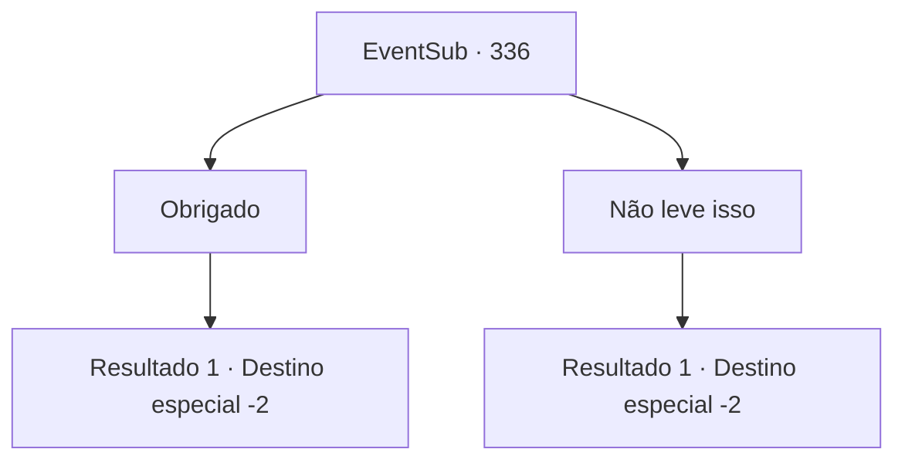

# Eventos secundários · 336

[Índice da tabela](index.md) · [Índice geral](../index.md)

ID: `pt:EventSub:336` · Fonte: `EventSub4` · Versão: 1.2.47.

Mapeamento estático dos arquivos; a disponibilidade e a execução dependem do estado da run.

## Texto do evento

*Sem texto no arquivo.*

## Dados de entrada

```json
{
  "id": 336,
  "grade": 1,
  "subEvent": "",
  "required": ""
}
```

## Mapa das escolhas



## Escolhas e resultados

### Escolha 1

Obrigado

Requisitos e outros campos da escolha:

```json
{
  "required": ""
}
```

#### Resultado 1.1

Você pega o objeto estranho entregue por ela. Você continua conversando com ela por um tempo, antes de finalmente se despedir. 

 "Adeus! E... não morra!"

 Cira te acompanha até fora da cidade, e você acena para ela se despedindo.

Continuação registrada: [Destino especial `-2`](../destinos-especiais.md).

```json
{
  "required": "",
  "chance": "1",
  "nextEvent": -2,
  "type": 2,
  "reward": "12_5_-1|14_5_6|3_170_1"
}
```

### Escolha 2

Não leve isso

Requisitos e outros campos da escolha:

```json
{
  "required": ""
}
```

#### Resultado 2.1

Você se recusa, dizendo a ela que não pode aceitar o presente dela. Ela então lhe entrega uma grande quantidade de ouro, exigindo que pelo menos você o aceite. 

 "Adeus! E... não morra!"

 Cira te acompanha até fora da cidade, e você acena para ela se despedindo.

Continuação registrada: [Destino especial `-2`](../destinos-especiais.md).

```json
{
  "required": "",
  "chance": "1",
  "nextEvent": -2,
  "type": 2,
  "reward": "12_5_-1|14_5_6|0_4_150"
}
```

## Referências que chegam a este evento

- [Evento 335 · escolha 1 · resultado 1](0335.md#escolha-1)
- [Evento 335 · escolha 2 · resultado 1](0335.md#escolha-2)
