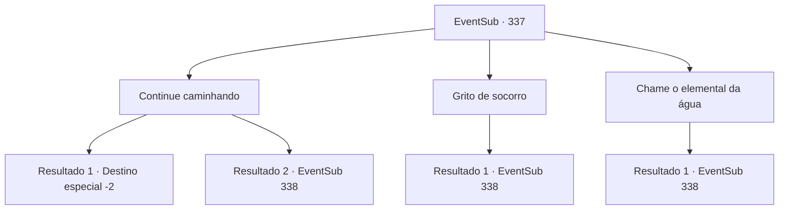

# Eventos secundários · 337

[Índice da tabela](index.md) · [Índice geral](../index.md)

ID: `pt:EventSub:337` · Fonte: `EventSub4` · Versão: 1.2.47.

Mapeamento estático dos arquivos; a disponibilidade e a execução dependem do estado da run.

## Texto do evento

|drawing_DryForest| Você está andando por uma floresta desolada e árida. As árvores estão todas secas, e você pode ver o que parece ser um rio, só que não há água e você pode ver o fundo. Faz horas desde que você se perdeu neste lugar. Você começa a perder a esperança, não encontrando uma saída mesmo depois de horas de caminhada. Você sente cada vez mais sede.

## Dados de entrada

```json
{
  "id": 337,
  "grade": 1,
  "subEvent": "",
  "required": "12_8_0"
}
```

## Mapa das escolhas



## Escolhas e resultados

### Escolha 1

Continue caminhando

Requisitos e outros campos da escolha:

```json
{
  "required": ""
}
```

#### Resultado 1.1

Você faz o seu melhor para ignorar a sede ardente em sua garganta e continua caminhando. Um passo. Outro passo. E mais um passo. Quanto mais você caminha, mais cansado fica. Mas logo, você finalmente consegue encontrar uma saída desta maldita floresta.

Continuação registrada: [Destino especial `-2`](../destinos-especiais.md).

```json
{
  "required": "",
  "chance": "1|0_13_1",
  "nextEvent": -2,
  "type": 0,
  "reward": "12_8_-1"
}
```

#### Resultado 1.2

Você faz o possível para ignorar a sede ardente na garganta e continuar andando. Um passo. Outro passo. E outro passo. O que você encontra não é a saída, mas o fato de você estar cansado demais para continuar. Você escurece, enquanto a escuridão encolhe sua visão.

 Você abre os olhos com o repentino toque de calor. Você olha em volta e encontra um círculo de pessoas, cercando uma fogueira. 

 "Nunca esperava encontrar um aventureiro aqui. Água?"

 Você está feliz em tomar a pele de água. As pessoas ao redor do fogo estão todas usando o que parecem capas criadas em couro de veado, cada uma com uma tatuagem estranha em seus rostos. Quando você pergunta quem eles são, eles se apresentam como os 'druidas', guardiões desta floresta.

Continuação registrada: [Evento 338](0338.md) na mesma tabela.

```json
{
  "required": "",
  "chance": "10",
  "nextEvent": 338,
  "type": 1,
  "reward": ""
}
```

### Escolha 2

Grito de socorro

Requisitos e outros campos da escolha:

```json
{
  "required": ""
}
```

#### Resultado 2.1

Você grita por ajuda, mas não ouve uma resposta. É como se você estivesse todo por você mesmo naquele lugar desolado. Então, você vê uma águia no céu, voando em direção a algum lugar. É como se a águia estivesse dizendo para você segui -lo. Você decide fazer exatamente isso. 

 Você nem percebe quanto tempo passou. A escuridão engole a floresta, mas você consegue encontrar um grupo de pessoas. 

 "Nunca esperava encontrar um aventureiro aqui. Você está livre para descansar aqui, se desejar."

 Quando você se aproxima cuidadosamente deles, um homem velho com uma longa barba fala com você, oferecendo -lhe uma pele de água. As pessoas ao redor do fogo estão todas usando o que parecem capas criadas em couro de veado, cada uma com uma tatuagem estranha em seus rostos. Quando você pergunta quem eles são, eles se apresentam como os 'druidas', guardiões desta floresta.

Continuação registrada: [Evento 338](0338.md) na mesma tabela.

```json
{
  "required": "",
  "chance": "1",
  "nextEvent": 338,
  "type": 2,
  "reward": ""
}
```

### Escolha 3

Chame o elemental da água

Requisitos e outros campos da escolha:

```json
{
  "required": "8_192_1"
}
```

#### Resultado 3.1

Você pega seu elemental de água e pede ajuda. Então, a coisa travessa espirra água no seu rosto e retorna à sua bolsa. Então, você vê uma águia no céu, voando em direção a algum lugar. É como se a águia estivesse dizendo para você segui -lo. Você decide fazer exatamente isso. 

 Você nem percebe quanto tempo passou. A escuridão engole a floresta, mas você consegue encontrar um grupo de pessoas. 

 "Nunca esperava encontrar um aventureiro aqui. E um elemento de água também."

 As pessoas ao redor do fogo estão todas usando o que parecem capas criadas em couro de veado, cada uma com uma tatuagem estranha em seus rostos. Quando você pergunta quem eles são, eles se apresentam como os 'druidas', guardiões desta floresta.

Continuação registrada: [Evento 338](0338.md) na mesma tabela.

```json
{
  "required": "",
  "chance": "1",
  "nextEvent": 338,
  "type": 2,
  "reward": ""
}
```

## Referências que chegam a este evento

Nenhum `nextEvent` positivo da mesma tabela aponta para este nó. Isso não prova que seja inacessível: sorteio e estado de história podem selecioná-lo.

