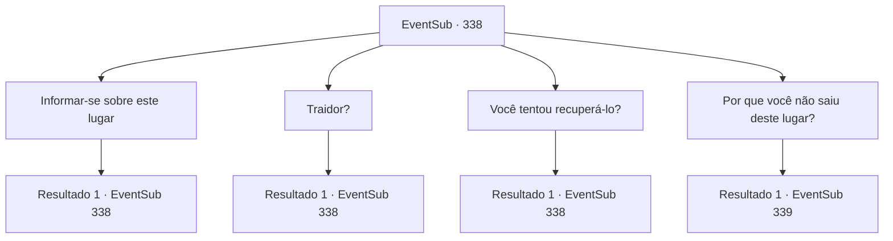

# Eventos secundários · 338

[Índice da tabela](index.md) · [Índice geral](../index.md)

ID: `pt:EventSub:338` · Fonte: `EventSub4` · Versão: 1.2.47.

Mapeamento estático dos arquivos; a disponibilidade e a execução dependem do estado da run.

## Texto do evento

*Sem texto no arquivo.*

## Dados de entrada

```json
{
  "id": 338,
  "grade": 1,
  "subEvent": "",
  "required": ""
}
```

## Mapa das escolhas



## Escolhas e resultados

### Escolha 1

Informar-se sobre este lugar

Requisitos e outros campos da escolha:

```json
{
  "required": "5_318_0"
}
```

#### Resultado 1.1


 "Esta floresta costumava ser exuberante e verde. Um lugar maravilhoso, que combina com o nome Floresta Silocient."

 Uma mulher se apresenta como 'Syannathel' e responde à sua pergunta. Ela é a mais jovem dos druidas e tem um par de olhos afiados que se assemelham aos de uma águia. 

 "Um traidor escapou com a 'Jóia da Vida' que costumava estar nesta floresta. É por isso que a floresta está assim."

 De acordo com Syannathel, esta Jóia da Vida é um artefato muito valioso, imbuido de poderes mágicos fortes. Ela acrescenta que se este artefato mágico for combinado com o ritual dos druidas, um ecossistema habitável pode ser formado na área ao redor dele, acolhendo diversas espécies de animais e plantas.

Continuação registrada: [Evento 338](0338.md) na mesma tabela.

```json
{
  "required": "",
  "chance": "1",
  "nextEvent": 338,
  "type": 2,
  "reward": "5_318_1"
}
```

### Escolha 2

Traidor?

Requisitos e outros campos da escolha:

```json
{
  "required": "5_318_1"
}
```

#### Resultado 2.1

Você pergunta sobre esse 'traidor' que fugiu com a Joia da Vida. Syannathel franze a testa, mas responde mesmo assim. 

 "Ele é um homem, conhecido pelo nome de 'Amakar'. Costumava ser um de nós... os druidas da Floresta de Silocient."

 Ela conta que um dia, o traidor conheceu uma mulher do mundo exterior e fugiu com a joia roubada no mesmo dia.

Continuação registrada: [Evento 338](0338.md) na mesma tabela.

```json
{
  "required": "",
  "chance": "1",
  "nextEvent": 338,
  "type": 2,
  "reward": "5_318_2"
}
```

### Escolha 3

Você tentou recuperá-lo?

Requisitos e outros campos da escolha:

```json
{
  "required": "5_318_2"
}
```

#### Resultado 3.1

Ouvindo a história dela, você pergunta por que eles não recuperaram a jóia. Ela responde que estava além do alcance deles. 

 "Não sabíamos para onde Amakar havia fugido com a jóia. Eu procurei com algumas pessoas, mas demoramos. Ele já estava bem longe."

 Só recentemente que eles descobriram seu paradeiro. Eles ouviram os rumores de 'Tomant', de que o novo proprietário mudou tremendamente a região. Depois de visitar Tomant, eles perceberam onde Amakar estava.

Continuação registrada: [Evento 338](0338.md) na mesma tabela.

```json
{
  "required": "",
  "chance": "1",
  "nextEvent": 338,
  "type": 2,
  "reward": "5_318_3"
}
```

### Escolha 4

Por que você não saiu deste lugar?

Requisitos e outros campos da escolha:

```json
{
  "required": "5_318_3"
}
```

#### Resultado 4.1

Quando você pergunta a ela por que os druidas não simplesmente deixaram a floresta, Syannathel sorri amargamente e responde. 

 "Este lugar é nossa casa. Onde mais viveríamos?"

 Ela olha ao redor da floresta desolada e explica o quão duro os druidas ancestrais trabalharam para proteger e cuidar da floresta. Quando sua explicação chega ao fim, seu olhar retorna para você. 

 "...Você é um aventureiro, certo? Talvez você possa ficar de olho no traidor para nós? Eu vou te mostrar a saída desta floresta!"

 Você é recebido não apenas com o olhar de Syannathel, mas também com o olhar dos outros druidas, cheios de esperança.

Continuação registrada: [Evento 339](0339.md) na mesma tabela.

```json
{
  "required": "",
  "chance": "1",
  "nextEvent": 339,
  "type": 2,
  "reward": ""
}
```

## Referências que chegam a este evento

- [Evento 337 · escolha 1 · resultado 2](0337.md#escolha-1)
- [Evento 337 · escolha 2 · resultado 1](0337.md#escolha-2)
- [Evento 337 · escolha 3 · resultado 1](0337.md#escolha-3)
- [Evento 338 · escolha 1 · resultado 1](0338.md#escolha-1)
- [Evento 338 · escolha 2 · resultado 1](0338.md#escolha-2)
- [Evento 338 · escolha 3 · resultado 1](0338.md#escolha-3)
