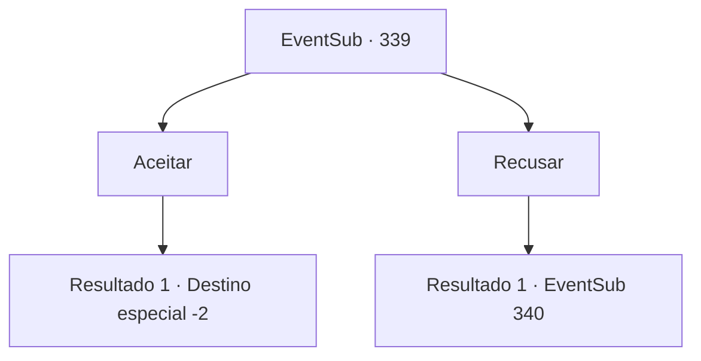

# Eventos secundários · 339

[Índice da tabela](index.md) · [Índice geral](../index.md)

ID: `pt:EventSub:339` · Fonte: `EventSub4` · Versão: 1.2.47.

Mapeamento estático dos arquivos; a disponibilidade e a execução dependem do estado da run.

## Texto do evento

*Sem texto no arquivo.*

## Dados de entrada

```json
{
  "id": 339,
  "grade": 1,
  "subEvent": "",
  "required": ""
}
```

## Mapa das escolhas



## Escolhas e resultados

### Escolha 1

Aceitar

Requisitos e outros campos da escolha:

```json
{
  "required": ""
}
```

#### Resultado 1.1

Você decide aceitar o pedido dela. Você assentia. Syannathel sorri alegremente e diz as características do traidor. |drawing_amakar| 

 "O traidor, Amakar, tem uma cicatriz na bochecha, um arranhão que você veria quando uma águia o ataca. Eu me dei essa cicatriz. Por favor, lembre-se disso."

 Você lentamente decorre para dormir, enquanto os outros druidas mantêm seus ouvidos satisfeitos com uma variedade de histórias e histórias. Na manhã seguinte, você segue o caminho que eles lhe disseram, deixando a floresta.

Continuação registrada: [Destino especial `-2`](../destinos-especiais.md).

```json
{
  "required": "",
  "chance": "1",
  "nextEvent": -2,
  "type": 2,
  "reward": "12_8_1"
}
```

### Escolha 2

Recusar

Requisitos e outros campos da escolha:

```json
{
  "required": ""
}
```

#### Resultado 2.1

Você educadamente recusa. Ela rapidamente se torna desanimada, mas não faz o pedido novamente.

 Na manhã seguinte, quando você abre os olhos, os druidas não estão lá. Eles provavelmente partiram de manhã cedo, a julgar pelos restos da fogueira. Você começa a se mover novamente, para encontrar uma saída da floresta silociente desolada.

Continuação registrada: [Evento 340](0340.md) na mesma tabela.

```json
{
  "required": "",
  "chance": "1",
  "nextEvent": 340,
  "type": 2,
  "reward": ""
}
```

## Referências que chegam a este evento

- [Evento 338 · escolha 4 · resultado 1](0338.md#escolha-4)
