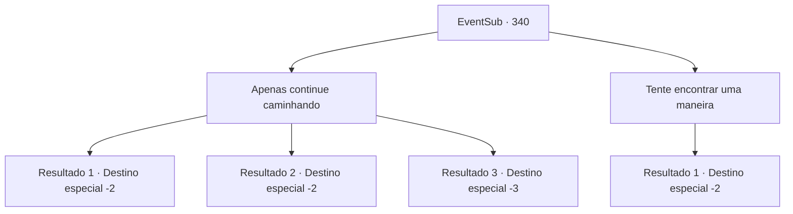

# Eventos secundários · 340

[Índice da tabela](index.md) · [Índice geral](../index.md)

ID: `pt:EventSub:340` · Fonte: `EventSub4` · Versão: 1.2.47.

Mapeamento estático dos arquivos; a disponibilidade e a execução dependem do estado da run.

## Texto do evento

*Sem texto no arquivo.*

## Dados de entrada

```json
{
  "id": 340,
  "grade": 1,
  "subEvent": "",
  "required": ""
}
```

## Mapa das escolhas



## Escolhas e resultados

### Escolha 1

Apenas continue caminhando

Requisitos e outros campos da escolha:

```json
{
  "required": ""
}
```

#### Resultado 1.1

Você se esforça para caminhar sem rumo pela floresta. A mesma paisagem continua sem fim. Você rapidamente fica cansado disso, mas depois de cerca de meio dia de caminhada, finalmente encontra uma saída. Você rapidamente passa pela saída e deixa a floresta.

Continuação registrada: [Destino especial `-2`](../destinos-especiais.md).

```json
{
  "required": "1_0_2",
  "chance": "1",
  "nextEvent": -2,
  "type": 2,
  "reward": "12_8_-1"
}
```

#### Resultado 1.2

Você se esforça para andar sem rumo pela floresta. Mas não importa o quanto você anda, você não encontra uma saída. Você só fica cada vez mais cansado. 

 Vários dias passam. Você já está exausto quando se deparar com o que parece uma saída. Você apressadamente faz o seu caminho para lá, com medo de perder de vista a saída.

Continuação registrada: [Destino especial `-2`](../destinos-especiais.md).

```json
{
  "required": "1_0_2",
  "chance": "1",
  "nextEvent": -2,
  "type": 2,
  "reward": "0_0_-1|12_8_-1"
}
```

#### Resultado 1.3

Você se esforça para caminhar sem rumo pela floresta. Mas não importa o quanto você caminhe, você não consegue encontrar uma saída. Você apenas fica cada vez mais cansado. Infelizmente, o cansaço vence você e você desaba no chão. Sua consciência tenta te levantar, mas seu corpo discorda.

Continuação registrada: [Destino especial `-3`](../destinos-especiais.md).

```json
{
  "required": "2_0_2",
  "chance": "1",
  "nextEvent": -3,
  "type": 2,
  "reward": "0_0_-1"
}
```

### Escolha 2

Tente encontrar uma maneira

Requisitos e outros campos da escolha:

```json
{
  "required": "1_7_15"
}
```

#### Resultado 2.1

Você decide procurar primeiramente por vestígios de movimento. Felizmente, você consegue rastrear alguns sinais dos druidas. Você se move rapidamente pelo caminho, seguindo seus sinais, e chega à saída da floresta.

Continuação registrada: [Destino especial `-2`](../destinos-especiais.md).

```json
{
  "required": "",
  "chance": "1",
  "nextEvent": -2,
  "type": 2,
  "reward": "12_8_-1"
}
```

## Referências que chegam a este evento

- [Evento 339 · escolha 2 · resultado 1](0339.md#escolha-2)
