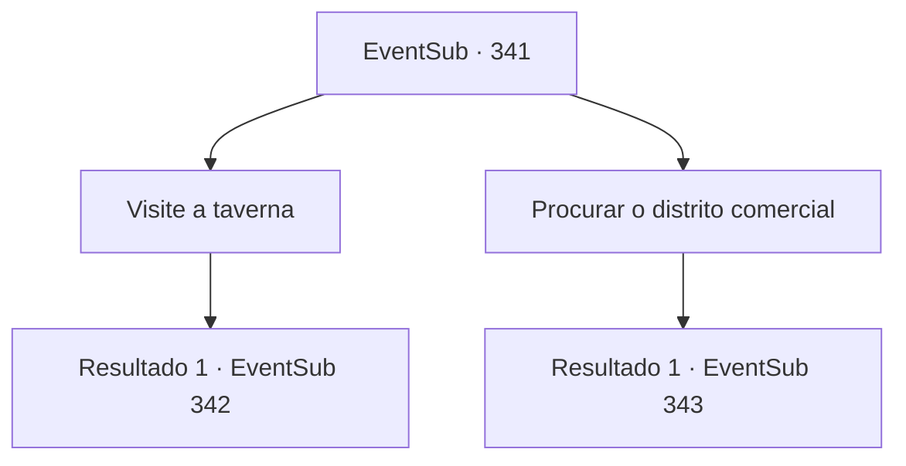

# Eventos secundários · 341

[Índice da tabela](index.md) · [Índice geral](../index.md)

ID: `pt:EventSub:341` · Fonte: `EventSub4` · Versão: 1.2.47.

Mapeamento estático dos arquivos; a disponibilidade e a execução dependem do estado da run.

## Texto do evento

Você chega em uma cidade chamada 'Tomant', procurando Amakar a pedido dos druidas. 

 "Saudações. Bem-vindo a Tomant."

 Depois de passar pelo posto de controle, você vê a paisagem de uma cidade extremamente próspera. Edifícios esplêndidos ficam entre as estradas limpas, e os aldeões trabalham alegremente. Você continua procurando por Amakar, o traidor da Floresta Silociente.

## Dados de entrada

```json
{
  "id": 341,
  "grade": 1,
  "subEvent": "",
  "required": "12_8_1"
}
```

## Mapa das escolhas



## Escolhas e resultados

### Escolha 1

Visite a taverna

Requisitos e outros campos da escolha:

```json
{
  "required": "5_319_0"
}
```

#### Resultado 1.1

Você entra em uma taverna e pergunta sobre o nome Amakar. Mas o dono da taverna parece ocupado demais lidando com os clientes sozinho. 

 "Desculpe, mas estou um pouco ocupado no momento! Se você tem algo a dizer, espere ali ou vá embora!"

 Ele grita com você e volta ao seu trabalho de mover pratos cheios de comida e bebidas.

Continuação registrada: [Evento 342](0342.md) na mesma tabela.

```json
{
  "required": "",
  "chance": "1",
  "nextEvent": 342,
  "type": 2,
  "reward": "5_319_1"
}
```

### Escolha 2

Procurar o distrito comercial

Requisitos e outros campos da escolha:

```json
{
  "required": ""
}
```

#### Resultado 2.1

Você vagueia pelo distrito comercial, perguntando sobre o nome Amakar. Mas os comerciantes evitam responder sua pergunta de forma zombeteira. 

 "Heh. Você realmente espera que nós forneçamos informações de graça? Vamos lá, compre algo. Talvez isso nos motive a dizer alguma coisa?"

 Os outros comerciantes parecem estar pensando a mesma coisa, com as mesmas expressões em seus rostos.

Continuação registrada: [Evento 343](0343.md) na mesma tabela.

```json
{
  "required": "",
  "chance": "1",
  "nextEvent": 343,
  "type": 2,
  "reward": ""
}
```

## Referências que chegam a este evento

Nenhum `nextEvent` positivo da mesma tabela aponta para este nó. Isso não prova que seja inacessível: sorteio e estado de história podem selecioná-lo.

