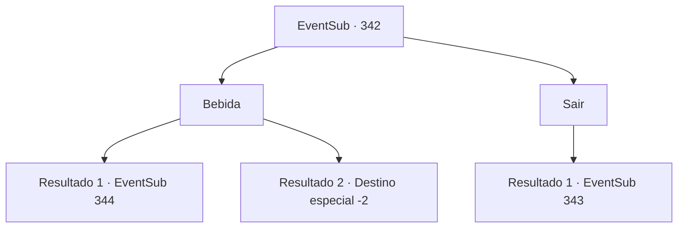

# Eventos secundários · 342

[Índice da tabela](index.md) · [Índice geral](../index.md)

ID: `pt:EventSub:342` · Fonte: `EventSub4` · Versão: 1.2.47.

Mapeamento estático dos arquivos; a disponibilidade e a execução dependem do estado da run.

## Texto do evento

*Sem texto no arquivo.*

## Dados de entrada

```json
{
  "id": 342,
  "grade": 1,
  "subEvent": "",
  "required": ""
}
```

## Mapa das escolhas



## Escolhas e resultados

### Escolha 1

Bebida

Requisitos e outros campos da escolha:

```json
{
  "required": "1_4_10"
}
```

#### Resultado 1.1

Você bebe sua cerveja, esperando o goleiro da taberna. Depois de esperar algumas horas, o horário de pico para a taberna passa e o guardião da taberna se aproxima de você. 

 "Sim ... então você deseja aprender sobre o Sr. Amakar?"

 Ele diz algumas coisas sobre Amakar. Primeiro, que ele é casado com Selis, filha do proprietário, e dois, que às vezes ele se visita como vice do proprietário. Três, que ele é hábil nas artes da astrologia e outros artesanato xamanista. E, finalmente, quatro, que ele desempenhou um papel crucial na mudança das terras estéreis de Tomant. 

 Você ouve informações da mansão do proprietário, onde Amakar presumivelmente reside, e sai da taberna. Enquanto você tenta entrar na mansão, no entanto, os guardas de segurança o impedem com suas lanças. Você decidiu encontrar outro caminho para a mansão.

Continuação registrada: [Evento 344](0344.md) na mesma tabela.

```json
{
  "required": "",
  "chance": "1|0_13_1",
  "nextEvent": 344,
  "type": 0,
  "reward": "0_4_-10|0_1_1"
}
```

#### Resultado 1.2

Você bebe sua cerveja, esperando o goleiro da taberna.

 Um... dois... três... 

 Você nem sabe o quanto bebe, mas se sente um pouco... embriagado. Então, sua consciência se encaixa como uma corda, e você desmaia.

 Você não sabe quanto tempo passou, mas acorda com os sons das vozes humanas. Ao olhar em volta, você vê um grupo de clientes olhando para você com desprezo. Você se levanta às pressas e sai da taberna, deixando os portões da cidade.

Continuação registrada: [Destino especial `-2`](../destinos-especiais.md).

```json
{
  "required": "",
  "chance": "8",
  "nextEvent": -2,
  "type": 1,
  "reward": "12_8_2"
}
```

### Escolha 2

Sair

Requisitos e outros campos da escolha:

```json
{
  "required": ""
}
```

#### Resultado 2.1

Você saiu do bar e caminhou pelo shopping perguntando sobre Amakar. Mas os comerciantes evitam responder sua pergunta de forma zombeteira. 

 "Heh. Você realmente espera que nós forneçamos informações de graça? Vamos lá, compre algo. Talvez isso nos motive a dizer algo?"

 Os outros comerciantes parecem estar pensando a mesma coisa, com as mesmas expressões em seus rostos.

Continuação registrada: [Evento 343](0343.md) na mesma tabela.

```json
{
  "required": "",
  "chance": "1",
  "nextEvent": 343,
  "type": 2,
  "reward": ""
}
```

## Referências que chegam a este evento

- [Evento 341 · escolha 1 · resultado 1](0341.md#escolha-1)
