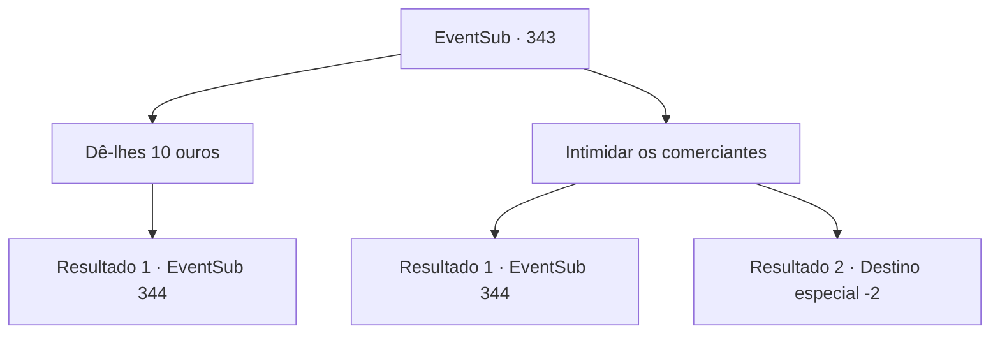

# Eventos secundários · 343

[Índice da tabela](index.md) · [Índice geral](../index.md)

ID: `pt:EventSub:343` · Fonte: `EventSub4` · Versão: 1.2.47.

Mapeamento estático dos arquivos; a disponibilidade e a execução dependem do estado da run.

## Texto do evento

*Sem texto no arquivo.*

## Dados de entrada

```json
{
  "id": 343,
  "grade": 1,
  "subEvent": "",
  "required": ""
}
```

## Mapa das escolhas



## Escolhas e resultados

### Escolha 1

Dê-lhes 10 ouros

Requisitos e outros campos da escolha:

```json
{
  "required": "1_4_10"
}
```

#### Resultado 1.1

Você coloca 10 moedas de ouro nas mãos do comerciante mais próximo e pergunta novamente. Com o ouro em suas mãos, o comerciante fala. 

 "Então você deseja saber sobre o Sr. Amakar?"

 Ela lhe conta algumas coisas sobre Amakar. Um, que ele está atualmente casado com Selis, a filha do senhorio, e dois, que ele às vezes visita a cidade pessoalmente como vice-senhorio. Três, que ele é habilidoso nas artes da astrologia e outras práticas xamânicas. E por último, quatro, que ele desempenhou um papel crucial na transformação das terras áridas de Tomant. Você ouve informações sobre a mansão do senhorio, onde Amakar presumivelmente reside, e sai da taverna. Ao tentar entrar na mansão, no entanto, os guardas de segurança o impedem com suas lanças. Você decide encontrar outra maneira de entrar na mansão.

Continuação registrada: [Evento 344](0344.md) na mesma tabela.

```json
{
  "required": "",
  "chance": "1",
  "nextEvent": 344,
  "type": 2,
  "reward": "0_4_-10"
}
```

### Escolha 2

Intimidar os comerciantes

Requisitos e outros campos da escolha:

```json
{
  "required": ""
}
```

#### Resultado 2.1

Você se aproxima do comerciante mais próximo e diz a ela para falar tudo o que sabe sobre Amakar, ameaçando machucá-la. Ela treme diante de você, antes de abrir a boca. 

 "Sr. Amakar, certo? Eu vou... eu vou te contar tudo! Só não me machuque!!"

 O comerciante lhe conta algumas coisas sobre Amakar. Um, que ele está atualmente casado com Selis, a filha do senhorio, e dois, que ele às vezes visita a cidade como vice-senhorio. Três, que ele é habilidoso nas artes da astrologia e outras práticas xamânicas. E por último, quatro, que ele desempenhou um papel crucial na transformação das terras áridas de Tomant. Você ouve informações sobre a mansão do senhorio, onde Amakar supostamente reside, e sai da taverna. Ao tentar entrar na mansão, no entanto, os guardas de segurança o impedem com suas lanças. Você decide encontrar outra maneira de entrar na mansão.

Continuação registrada: [Evento 344](0344.md) na mesma tabela.

```json
{
  "required": "",
  "chance": "1|0_12_1",
  "nextEvent": 344,
  "type": 0,
  "reward": "0_2_1"
}
```

#### Resultado 2.2

Apesar de suas tentativas de intimidação, os comerciantes não se movem. Quando eles gritam com raiva que vão chamar os guardas da cidade, você não pode deixar de fugir.

 Então, você se move pela cidade, coletando toda e qualquer informação sobre Amakar. Mas mesmo depois de vários dias, você não encontra nada definitivo. Amakar acaba sendo muito bom em se esconder. Infelizmente, você decide desistir de encontrá -lo e deixar Toment. Os sons da cidade jubilosa ficam mais fracos à medida que você se move.

Continuação registrada: [Destino especial `-2`](../destinos-especiais.md).

```json
{
  "required": "",
  "chance": "11",
  "nextEvent": -2,
  "type": 1,
  "reward": "12_8_2"
}
```

## Referências que chegam a este evento

- [Evento 341 · escolha 2 · resultado 1](0341.md#escolha-2)
- [Evento 342 · escolha 2 · resultado 1](0342.md#escolha-2)
