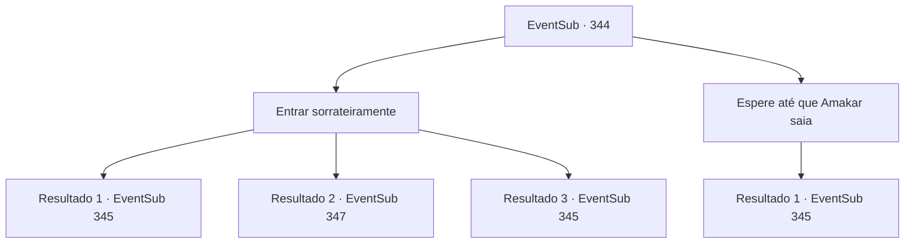

# Eventos secundários · 344

[Índice da tabela](index.md) · [Índice geral](../index.md)

ID: `pt:EventSub:344` · Fonte: `EventSub4` · Versão: 1.2.47.

Mapeamento estático dos arquivos; a disponibilidade e a execução dependem do estado da run.

## Texto do evento

*Sem texto no arquivo.*

## Dados de entrada

```json
{
  "id": 344,
  "grade": 1,
  "subEvent": "",
  "required": ""
}
```

## Mapa das escolhas



## Escolhas e resultados

### Escolha 1

Entrar sorrateiramente

Requisitos e outros campos da escolha:

```json
{
  "required": ""
}
```

#### Resultado 1.1

Você se esconde dos olhos dos guardas e pula sobre a cerca, conseguindo entrar furtivamente nos jardins. Felizmente, você consegue chegar à mansão sem ser notado, mas as portas estão trancadas. Enquanto decide procurar outras maneiras de entrar na mansão, as portas se abrem e um homem alto pode ser visto. Ele te vê antes das portas e então sussurra para você com uma voz baixa. 

 "... Os druidas te enviaram, não é mesmo?"

 Julgando pela cicatriz em sua bochecha, ele é de fato o homem que você está procurando. Ele te leva para o quarto de hóspedes dentro da mansão e então fala novamente. 

 "*suspiro*... Não vou prolongar isso, para o bem de nós dois. Você não poderia simplesmente deixar este lugar, silenciosamente? Eu até posso te prometer algo valioso, se quiser."


Continuação registrada: [Evento 345](0345.md) na mesma tabela.

```json
{
  "required": "21_5_2",
  "chance": "1|0_6_1",
  "nextEvent": 345,
  "type": 0,
  "reward": ""
}
```

#### Resultado 1.2

Tentas saltar por cima das cercas sem seres notado, mas os guardas encontram-te. Claro, eles param-te. 

 "INTRUSO! AQUI! Apanhem-no!"

 As pontas afiadas das suas lanças e lâminas encontram-te.

Continuação registrada: [Evento 347](0347.md) na mesma tabela.

```json
{
  "required": "21_5_2",
  "chance": "11",
  "nextEvent": 347,
  "type": 1,
  "reward": "6_0_21",
  "place": 4
}
```

#### Resultado 1.3

Você se esconde dos olhos dos guardas e pula sobre a cerca, conseguindo entrar furtivamente nos jardins. Felizmente, você consegue chegar à mansão sem ser notado, mas as portas estão trancadas. Enquanto decide procurar outras maneiras de entrar na mansão, as portas se abrem e um homem alto pode ser visto. Ele te vê antes das portas e então sussurra para você com uma voz baixa. 

 "... Os druidas te enviaram, não é mesmo?"

 Julgando pela cicatriz em sua bochecha, ele é de fato o homem que você está procurando. Ele te leva para o quarto de hóspedes dentro da mansão e então fala novamente. 

 "*suspiro*... Não vou prolongar isso, para o bem de nós dois. Você não poderia simplesmente deixar este lugar, silenciosamente? Eu até posso te prometer algo valioso, se quiser."


Continuação registrada: [Evento 345](0345.md) na mesma tabela.

```json
{
  "required": "20_5_2",
  "chance": "1",
  "nextEvent": 345,
  "type": 2,
  "reward": ""
}
```

### Escolha 2

Espere até que Amakar saia

Requisitos e outros campos da escolha:

```json
{
  "required": ""
}
```

#### Resultado 2.1

Você decide esperar nos portões da mansão. Os guardas não parecem se importar. Afinal, você está apenas esperando. Depois de um tempo aparentemente interminável de espera, você ouve uma voz vindo de trás. 

 "Você é... Os druidas te enviaram, não é?"

 Você se vira para encontrar o dono da voz e percebe que ele é o próprio homem que você está procurando, julgando pela cicatriz em sua bochecha. Ele te leva para o quarto de hóspedes dentro da mansão e então fala novamente. 

 "*suspiro*... Não vou prolongar isso, para nós dois. Você não poderia simplesmente deixar este lugar, silenciosamente? Eu até posso te prometer algo valioso, se quiser."


Continuação registrada: [Evento 345](0345.md) na mesma tabela.

```json
{
  "required": "",
  "chance": "1",
  "nextEvent": 345,
  "type": 2,
  "reward": ""
}
```

## Referências que chegam a este evento

- [Evento 342 · escolha 1 · resultado 1](0342.md#escolha-1)
- [Evento 343 · escolha 1 · resultado 1](0343.md#escolha-1)
- [Evento 343 · escolha 2 · resultado 1](0343.md#escolha-2)
